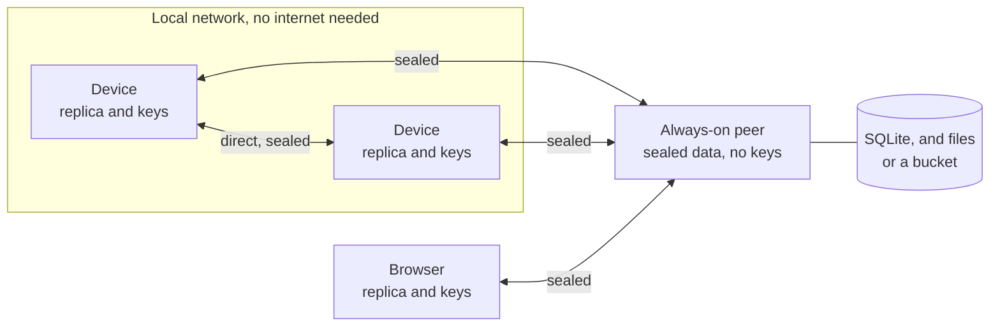
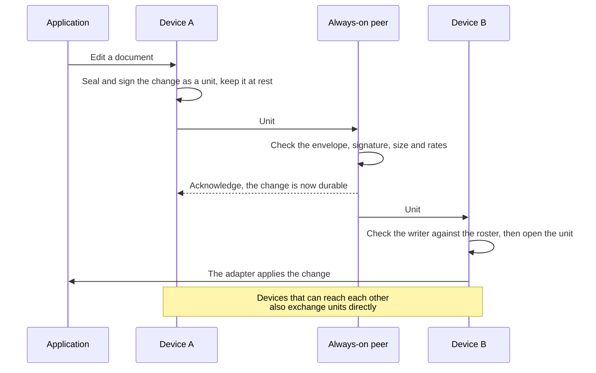
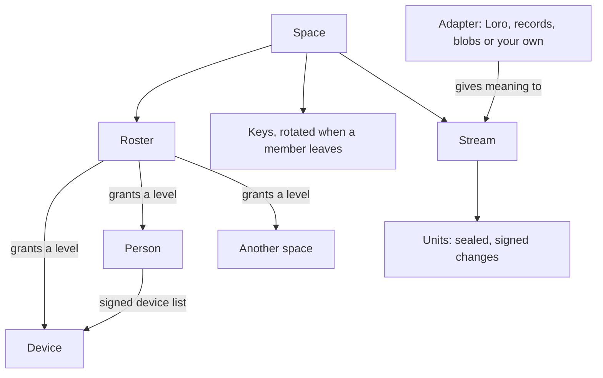
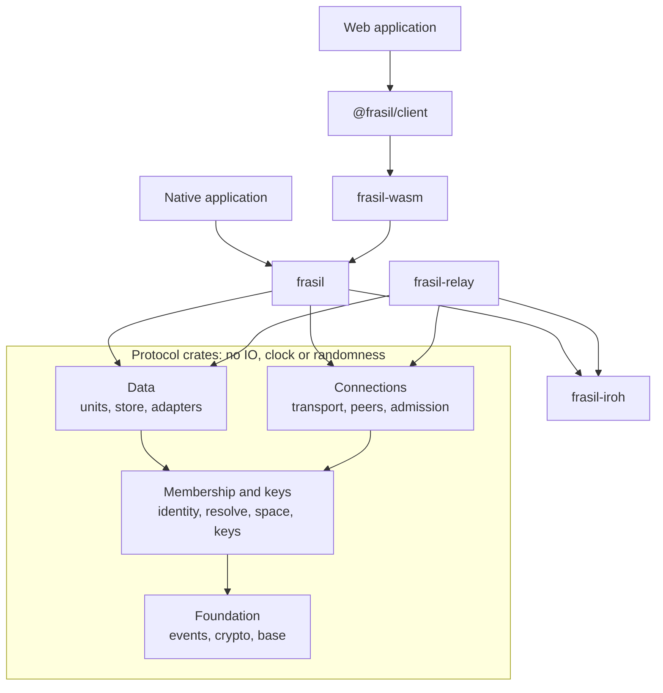

# Frasil

**Private, cloud-optional collaboration framework.**

> **Under active development.** Frasil is not yet recommended for production
> use. Protocol 1 is the current protocol; an incompatible change is a new
> protocol number. The design and code have not had an independent security
> review.

Frasil gives an application shared data that stays in sync between people
and their devices: through a server, over a local network with no internet,
across the internet through a relay, or all of these at once. Frasil handles who people are, who may read and write, the keys and
the sync. The application decides what its data means.

## At a glance

Every device keeps its own replica. Devices sync directly, through an
always-on peer, or both, and the same sealed, signed data travels each way.



A change is sealed and signed on the device that made it. A peer stores and
forwards it without being able to read it, and every other replica checks it
for itself.



[How Frasil works](https://github.com/transcodeworks/frasil/blob/main/docs/how-it-works.md) follows joining, removal, recovery
and the keys in the same way.

## What you get

- **A server is optional.** Devices sync directly on a local network,
  across the internet through an iroh relay, through an always-on peer, or
  any of these at once. Membership, keys and sync work the same way in
  every case.
- **The server holds no keys.** An always-on peer stores and relays sealed
  changes. It cannot read content, names or rosters, and replicas refuse
  anything it forges or alters.
- **Shared spaces with signed membership.** A space is the unit of sharing:
  a notebook, a board, a team's project. Its roster says who reads, writes
  and administers, and every replica checks it, with no central authority.
  Removing a member rotates the space's keys.
- **People, not logins.** A person is a set of devices that approve one
  another by comparing a code. Someone who loses every device comes back
  with a recovery key or a passkey. Accounts at an identity provider are
  optional and only help people find each other.
- **Your data model.** Built-in adapters cover Loro documents, record
  tables and files. An application can add its own.
- **Live traffic and guests.** Presence, cursors and other live messages
  travel sealed beside the data. A guest can join one space for a session
  and see nothing else.

## The concepts

| Term | What it is |
|---|---|
| Device | One installation of an application, with its own keys |
| Person | The devices one person owns, listed and signed by each other |
| Space | What is shared, with its own roster and keys. It holds many documents |
| Roster | The signed record of who may read, write and administer a space |
| Stream | One document's changes inside a space |
| Adapter | The code that gives a stream meaning: Loro, records, blobs or your own |
| Always-on peer | A server that stores and relays sealed changes, for availability only |



## What Frasil does not do

- A removed member keeps what they already received. Removal protects what
  is written afterwards.
- A peer sees sizes, timing, which devices write and how often keys change.
  Frasil does not hide traffic patterns.
- A peer cannot query or index content. Search, totals and uniqueness are
  computed on clients.
- With no always-on peer, changes move only while the devices are
  connected, and two devices find each other again only until their
  endpoint keys rotate. See
  [collaborating with no peer](https://github.com/transcodeworks/frasil/blob/main/docs/how-it-works.md#collaborating-with-no-peer).

## This repository

This repository is the implementation of Frasil's protocol 1, written from
its specification in [`docs/spec/`](https://github.com/transcodeworks/frasil/blob/main/docs/spec/README.md). The
[overview](https://github.com/transcodeworks/frasil/blob/main/docs/spec/overview.md) is the place to start for the full model
and threat model.

## Start here

An application depends on one crate, [`frasil`](https://github.com/transcodeworks/frasil/blob/main/crates/frasil). A `Device`
keeps its records sealed in a `Storage`, holds `Space`s, and connects to
peers by URL. A space holds Loro documents, record tables and files.
Add it with `cargo add frasil`, or in `Cargo.toml`:

```toml
frasil = "0.1"
```

In a clone of this repository, these commands run the peer and an example:

```sh
FRASIL_DATA_DIR=$(mktemp -d) cargo run -p frasil-relay
cargo run -p frasil --features server,iroh,adapter-loro --example shared_note
```

The first command starts a peer on loopback. In a second terminal,
[`shared_note`](https://github.com/transcodeworks/frasil/blob/main/crates/frasil/examples/shared_note.rs) has two devices share
a note through it: one creates a space and admits the other by an invitation
and a compared code, and both edit the note at once. Nothing leaves the
machine. The crate's documentation
(`cargo doc -p frasil --open`) starts from the same example.

A browser application uses the npm package
[`@frasil/client`](https://github.com/transcodeworks/frasil/blob/main/packages/frasil), the same client compiled to
WebAssembly:

```sh
npm install @frasil/client
```

The peer is also published as the container image
`ghcr.io/transcodeworks/frasil-relay`; [Self-hosting a peer](https://github.com/transcodeworks/frasil/blob/main/docs/self-hosting.md)
says how to run it.

## The crates

An application sees one crate or one npm package. The protocol crates sit
underneath, and the client and the peer share them.



| What | Where |
|---|---|
| The developer crate: devices, spaces, streams, peers and admission, with sync, durability and key upkeep running by themselves. `frasil::advanced` exposes the engine underneath, one call per procedure of the specification | [`crates/frasil`](https://github.com/transcodeworks/frasil/blob/main/crates/frasil) |
| The protocol crates, one or more per document of the specification: `frasil-base`, `frasil-crypto`, `frasil-events`, `frasil-identity`, `frasil-keys`, `frasil-space`, `frasil-resolve`, `frasil-admission`, `frasil-units`, `frasil-store`, `frasil-peers`, `frasil-transport`, the adapters (`frasil-adapter`, `frasil-adapter-loro`, `frasil-adapter-records`, `frasil-adapter-blobs`) and the extensions' crates (`frasil-ephemeral`, `frasil-libraries`, `frasil-app-requests`, `frasil-drive`, `frasil-deposit-tokens`, `frasil-space-file`). They hold no IO, clock or randomness of their own. They are internal building blocks, less stable than `frasil` | [`crates/frasil-*`](https://github.com/transcodeworks/frasil/blob/main/crates) |
| `frasil-index-derive`: the derive macro of `frasil`'s `index` feature | [`crates/frasil-index-derive`](https://github.com/transcodeworks/frasil/blob/main/crates/frasil-index-derive) |
| The iroh binding, for member connections, local discovery and pairing | [`crates/frasil-iroh`](https://github.com/transcodeworks/frasil/blob/main/crates/frasil-iroh) |
| The peer service, `frasil-relay`: an always-on peer over the server binding (HTTP and WebSocket) and the iroh binding, storing in SQLite and a directory or an S3-compatible bucket, and optionally an iroh relay for devices with no direct path | [`apps/relay`](https://github.com/transcodeworks/frasil/blob/main/apps/relay) |
| The browser package: `frasil-wasm` binds the client with `wasm-bindgen`, and `@frasil/client` puts a TypeScript layer on it | [`crates/frasil-wasm`](https://github.com/transcodeworks/frasil/blob/main/crates/frasil-wasm), [`packages/frasil`](https://github.com/transcodeworks/frasil/blob/main/packages/frasil) |
| The conformance tests: clients against a running `frasil-relay` | [`tests/conformance`](https://github.com/transcodeworks/frasil/blob/main/tests/conformance) |
| The test vector loader and the claims check | [`crates/frasil-testkit`](https://github.com/transcodeworks/frasil/blob/main/crates/frasil-testkit) |

Each crate's `claims.txt` lists the vector families of `docs/spec/vectors/`
it passes. `frasil-testkit` checks that every family is claimed exactly
once.

## Extensions

The core protocol is the default build. Each extension of the specification
is a Cargo feature, off by default, on `frasil` and on the crates it touches.
`frasil-relay` builds in every extension a peer serves, and its operator
turns each on when it starts, with `FRASIL_EXTENSIONS`; `libraries` and
`deposit-tokens` are on unless the operator names other extensions, so
that a new peer hosts a space only under a ticket its operator hands out,
and a deposit in a device mailbox can be paid for with a token
([Self-hosting a peer](https://github.com/transcodeworks/frasil/blob/main/docs/self-hosting.md#extensions)):

| Feature | Specification | At `frasil-relay` |
|---|---|---|
| `ext-invite-links` | [ext-invite-links.md](https://github.com/transcodeworks/frasil/blob/main/docs/spec/ext-invite-links.md) | `invite-links`, for the drops it keeps |
| `ext-recovery-agent` | [ext-recovery-agent.md](https://github.com/transcodeworks/frasil/blob/main/docs/spec/ext-recovery-agent.md) | |
| `ext-restricted-spaces` | [ext-restricted-spaces.md](https://github.com/transcodeworks/frasil/blob/main/docs/spec/ext-restricted-spaces.md) | |
| `ext-guests` | [ext-guests.md](https://github.com/transcodeworks/frasil/blob/main/docs/spec/ext-guests.md) | |
| `ext-next-endpoints` | [ext-next-endpoints.md](https://github.com/transcodeworks/frasil/blob/main/docs/spec/ext-next-endpoints.md) | |
| `ext-libraries` | [ext-libraries.md](https://github.com/transcodeworks/frasil/blob/main/docs/spec/ext-libraries.md) | `libraries`, for attachments and ledgers |
| `ext-app-requests` | [ext-app-requests.md](https://github.com/transcodeworks/frasil/blob/main/docs/spec/ext-app-requests.md) | |
| `ext-deposit-tokens` | [ext-deposit-tokens.md](https://github.com/transcodeworks/frasil/blob/main/docs/spec/ext-deposit-tokens.md) | `deposit-tokens` |
| `ext-drive` | [ext-drive.md](https://github.com/transcodeworks/frasil/blob/main/docs/spec/ext-drive.md) | |
| `ext-file-versions` | [ext-file-versions.md](https://github.com/transcodeworks/frasil/blob/main/docs/spec/ext-file-versions.md) | `file-versions`, for retention of superseded objects |
| `space-files` | [ext-space-files.md](https://github.com/transcodeworks/frasil/blob/main/docs/spec/ext-space-files.md) | |
| `ephemeral` | [ext-ephemeral.md](https://github.com/transcodeworks/frasil/blob/main/docs/spec/ext-ephemeral.md) | `ephemeral`, to relay the channel |

Other features of `frasil`: `sqlite`, `iroh`, `server`, `adapter-loro`,
`adapter-records` and `adapter-blobs` are on by default. `server-socket`
runs the server binding over a WebSocket and HTTP the application supplies;
`browser` builds a device for `wasm32-unknown-unknown`, with the browser's
tasks, clocks and `fetch`, and `Storage::indexed_db`. `index` adds a typed
local SQLite cache over many spaces, encrypted at rest, with tables that are
plain structs deriving `Table`; `index-diesel` adds typed Diesel queries over
it, and `index-vendored-openssl` builds SQLCipher's crypto from a vendored
OpenSSL for native targets without a system library (Android, Linux,
Windows).

`partial-replicas` turns on partial replicas ([units.md](https://github.com/transcodeworks/frasil/blob/main/docs/spec/units.md),
section 3.15). `frasil`'s `p1-full` feature turns on every binding,
adapter and extension it implements.

## Guides

- [How Frasil works](https://github.com/transcodeworks/frasil/blob/main/docs/how-it-works.md)
- [Self-hosting a peer](https://github.com/transcodeworks/frasil/blob/main/docs/self-hosting.md)
- [WebAssembly and the browser package](https://github.com/transcodeworks/frasil/blob/main/docs/webassembly.md)
- [Fuzzing](https://github.com/transcodeworks/frasil/blob/main/docs/fuzzing.md)
- [Links into documents](https://github.com/transcodeworks/frasil/blob/main/docs/links.md)
- [Lending a Loro document to the application](https://github.com/transcodeworks/frasil/blob/main/docs/one-document.md)
- [History: who changed what, when](https://github.com/transcodeworks/frasil/blob/main/docs/history.md)
- [Undo, versions and review](https://github.com/transcodeworks/frasil/blob/main/docs/undo-versions-review.md)
- [A local index over many spaces](https://github.com/transcodeworks/frasil/blob/main/docs/index.md)
- [Reading, following and caching synced data](https://github.com/transcodeworks/frasil/blob/main/docs/reading-and-caching.md)
- [Deposit tokens and delayed deliveries](https://github.com/transcodeworks/frasil/blob/main/docs/deposit-tokens.md)
- [Checkpoints](https://github.com/transcodeworks/frasil/blob/main/docs/checkpoints.md)

## Checks

```sh
cargo fmt --all -- --check
cargo clippy --workspace --all-targets -- -D warnings
cargo clippy --workspace --all-targets --all-features -- -D warnings
node scripts/fetch-wycheproof.mjs
cargo test --workspace
cargo test --workspace --all-features
scripts/check-wasm.sh        # frasil-wasm on wasm32, in Node.js
scripts/check-mobile.sh      # frasil for iOS and Android
scripts/check-browser.sh     # frasil's browser feature, in a page and a worker
scripts/check-js.sh          # the npm package, in Chromium and WebKit
scripts/fuzz.sh --build-only # every fuzz target, with cargo-fuzz on nightly
cargo deny check
```

`docs/spec/reference/generate.py --check` regenerates every vector file
and compares it with the committed one; see
[the specification's README](https://github.com/transcodeworks/frasil/blob/main/docs/spec/README.md).

## Contributing

See [CONTRIBUTING.md](https://github.com/transcodeworks/frasil/blob/main/CONTRIBUTING.md) for building, testing and changing the
specification, and the [code of conduct](https://github.com/transcodeworks/frasil/blob/main/CODE_OF_CONDUCT.md). Report
vulnerabilities privately, as [SECURITY.md](https://github.com/transcodeworks/frasil/blob/main/SECURITY.md) describes.

## License

Frasil is MIT. See [LICENSE](https://github.com/transcodeworks/frasil/blob/main/LICENSE).
