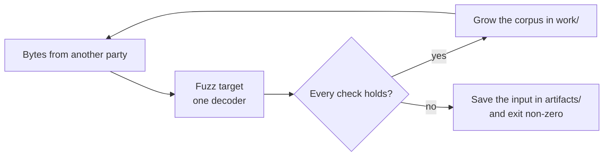
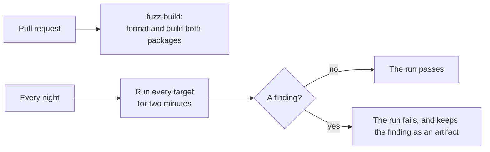

# Fuzzing

Every decoder of bytes that another party sent has a coverage-guided fuzz
target. A device treats peers and other devices as untrusted, and a peer
treats devices as untrusted, so each of these readers faces an adversary.

The targets run with [cargo-fuzz](https://github.com/rust-fuzz/cargo-fuzz)
and libFuzzer on a nightly toolchain, under AddressSanitizer, with debug
assertions and overflow checks on: an overflow is a crash, not a wrapped
value.



## What every target checks

- **No panic on any input.** In a browser a panic traps the WebAssembly
  module, and every key it holds goes with it.
- **No unbounded memory or time.** Each run limits memory per input and per
  allocation, and time per input. Exceeding a limit is a finding, like a
  crash.
- **Only the document's error classes, in its order.** A reader refuses
  only with the classes its procedure names, at the step that names them.
- **One encoding.** What a reader accepts is the one encoding of what it
  returns: writing it back gives the bytes read.
- **No forgery.** Where a reader checks a signature, nothing passes that
  the fixed signer of the target did not sign.

## Running them

```sh
rustup toolchain install nightly
scripts/fuzz.sh                       # every target for 60 seconds
scripts/fuzz.sh 600 units_body        # one target for 10 minutes
scripts/fuzz.sh --jobs 4 300          # four at a time, 5 minutes each
scripts/fuzz.sh --build-only          # build every target, run none
scripts/fuzz.sh --list
```

The script installs cargo-fuzz, at the version it pins, into
`target/fuzz-tools` unless that version is already on the `PATH`. It
installs nothing system-wide. It builds every target with
`--all-features`, so the targets of every extension build and run. It
prints executions, coverage and corpus size per target, and exits
non-zero if any target found a crash, an out-of-memory input or a timeout.

Each run grows its corpus in `<package>/work/<target>/` and saves a finding
in `<package>/artifacts/<target>/`. A seed corpus checked in under
`<package>/corpus/<target>/` is read too. To replay a finding:

```sh
cargo +nightly fuzz run --fuzz-dir fuzz --all-features <target> fuzz/artifacts/<target>/<file>
```

Inputs are at most 16 KiB: a hybrid signature alone takes 3,373 bytes.

## In CI



- On every pull request, the `fuzz-build` job formats and builds both
  packages with every feature, from their committed lockfiles.
- Every night, `.github/workflows/fuzz.yml` builds every target with
  cargo-fuzz on a GitHub-hosted runner and runs each for two minutes, one
  target per core, within a 90-minute limit. A finding fails the run and is
  kept as an artifact. Each target's corpus is kept in the Actions cache
  from one night to the next.

## The packages

The targets are in two packages. Each is a workspace of its own, so the
main workspace never builds them or their dependencies.

- [`fuzz/`](../fuzz): the protocol crates, the adapters, the
  extensions' crates and the developer crate's intake.
- [`apps/relay/fuzz`](../apps/relay/fuzz): the peer's own
  records at rest. Each target takes the module of `frasil-relay` it fuzzes
  as a source file of its own, so the package builds none of the peer's
  network stack.

A target that needs an extension names its feature in `required-features`.

## The targets

| Target | What it reads |
|---|---|
| `base_cbor` | Deterministic CBOR, whole and streamed |
| `crypto_signature` | Signatures of schemes 0 and 2, the kind's policy, the ML-DSA-65 decoder |
| `crypto_wrap` | The X-Wing wrap's layout, and opening it |
| `events_decode` | Signed events, refs and equivocation proofs |
| `identity_body` | The device-list event's body and its checks |
| `identity_list_event` | List events placed and merged into a device list |
| `identity_entry` | Recovery entries |
| `identity_fingerprint` | Fingerprints as text |
| `identity_link` | Account links, unlinks and user handles |
| `identity_sheet` | Recovery sheets as text |
| `keys_body` | A space event's visible and sealed parts |
| `keys_reference` | Key names, key references, links, gap records, bundles and wraps |
| `keys_sealed_name` | Sealed names |
| `space_roster_part` | The roster part of a genesis and of an update |
| `admission_message` | Admission messages, offers, seals, bodies, the welcome and the Join |
| `admission_records` | Signed records, sealed welcomes, lists, exchange mailboxes, lookups and access requests |
| `admission_text` | QR codes and setup codes as text |
| `units_body` | Signed units, visible bodies, sealed parts, Frasil's own units, stream snapshots and objects |
| `units_messages` | Sync messages |
| `units_space_snapshot` | Space snapshots |
| `units_statement` | Head statements |
| `store_record` | Records at rest |
| `store_sealed_keys` | Sealed device keys |
| `store_mark` | The mark, and continuity |
| `peers_storage_body` | Storage event bodies |
| `peers_merge_statement` | Merge statements |
| `transport_frame` | Frames, whole and in pieces, and every message type |
| `transport_handshake` | The member and device-to-peer handshakes |
| `transport_mailbox` | Mailbox items and the collection check |
| `transport_ticket` | Tickets as text |
| `transport_addresses` | `Addresses`, member tickets of a space's other members |
| `transport_lan` | Local-network packets, member and nearby announcements |
| `adapter_loro` | Loro units, blob metadata and stream snapshots |
| `adapter_loro_blob` | Loro updates blobs with a right checksum, through blob metadata, units and import |
| `adapter_loro_snapshot` | Loro snapshot states whose exports have right checksums, through the snapshot checks and the load |
| `adapter_records` | Records units and stream snapshots |
| `adapter_blobs` | Blobs units, key references and stream snapshots |
| `app_requests_headers` | Device-signed request headers |
| `app_requests_statement` | The request statement and list deliveries |
| `ephemeral_outer` | The ephemeral channel's outer frame, and relaying it |
| `ephemeral_inner` | Its inner map and names |
| `ephemeral_plaintext` | Its padding, core and the whole receiver |
| `libraries_ticket` | Library tickets and their check |
| `libraries_attach` | `LibraryAttach` |
| `client_sync` | The developer crate's intake of a sync message, through a sync session |
| `client_public_keys` | A device's three public keys, read only under the device ID they hash to |
| `ext_invite_links_change` | Invite grants and successors (`ext-invite-links`) |
| `ext_invite_links_link` | The link's fragment and the drop (`ext-invite-links`) |
| `ext_invite_links_messages` | The drop's mailbox messages (`ext-invite-links`) |
| `ext_next_endpoints_message` | `NextEndpoint` (`ext-next-endpoints`) |
| `ext_restricted_spaces_reference` | A restricted space's key reference (`ext-restricted-spaces`) |
| `ext_restricted_spaces_move` | Move records (`ext-restricted-spaces`) |
| `ext_guests_leave_request` | Leave requests and offers with a guest preset (`ext-guests`) |
| `deposit_tokens_keys_get` | `TokenKeysGet` (`ext-deposit-tokens`) |
| `deposit_tokens_keys` | `TokenKeys` and a device's checks of a key list and its history (`ext-deposit-tokens`) |
| `deposit_tokens_request` | `TokenRequest`, a peer's checks of it, and issuing (`ext-deposit-tokens`) |
| `deposit_tokens_issue` | `TokenIssue` and a device's finishing of a batch (`ext-deposit-tokens`) |
| `deposit_tokens_put` | `MailboxPut` with a token, and a peer's checks of the deposit (`ext-deposit-tokens`) |
| `deposit_tokens_header` | The server binding's `Frasil-Token` header (`ext-deposit-tokens`) |
| `deposit_tokens_grant` | Library tickets read where the peer implements deposit tokens: the grant (`ext-deposit-tokens`) |
| `relay_records` | The peer's journal and object index records, and its device mailboxes' items and claims |
| `relay_object_front` | An object's front, as the peer lays out its chunks |
| `relay_library_records` | The peer's library records, with deposit tokens' allowance windows and grants used |
| `relay_deposit_records` | The peer's deposit keys and spent tokens |
| `relay_cluster_frames` | The frames of the links between a cluster's nodes, and every body they carry that is not JSON |
| `relay_cluster_json` | The bodies of those links that are JSON: Raft's messages, proposals and joins, and their answers |
| `relay_cluster_handshake` | The handshake of those links: its messages, its MACs and the keys it derives |

Each target's first comment names the sections of the specification it
covers and the properties it asserts.

## Property tests

Some properties need structured inputs rather than bytes. They are
[proptest](https://github.com/proptest-rs/proptest) tests and run under
plain `cargo test`:

- `frasil-resolve` (`src/proptests.rs`): over random logs, the verdicts
  do not depend on the order events arrive in, and equal those of a
  step-by-step transcription of the procedure;
- the adapters (`tests/orders.rs` of each): a stream's units, handed over
  in any order and any number of times, give one state, and a snapshot of
  any causal cut rebuilds to it;
- `frasil-crypto` (`tests/properties.rs`): the key checks and the wrap on
  arbitrary input.

## Adding a target

A change that adds a decoder adds its target in a file of its own under
`fuzz/fuzz_targets/` (or `apps/relay/fuzz/fuzz_targets/` for the peer's own
records), and a `[[bin]]` entry in that package's `Cargo.toml`. The target
asserts the properties above that apply, and its first comment says which.
