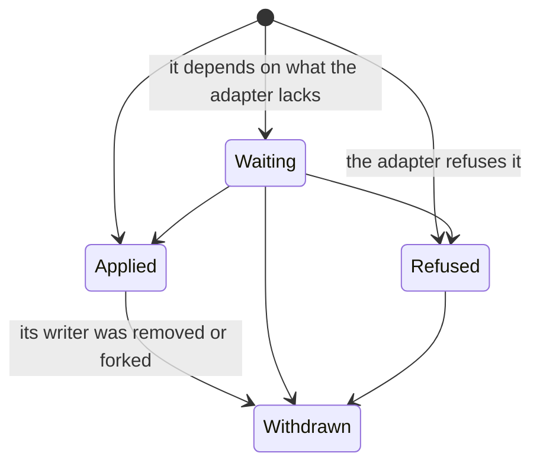

# History: who changed what, when

Frasil's high-level crate and npm package answer, for every document and
table, "who changed this, when, from what". It is built on the
protocol as specified, with nothing added to it: a change is the unit that
carried it, and a unit is signed by the device that wrote it, so attribution comes from signatures that no member can
fake, and names from the roster. This page is the walk-through; the docs
of `frasil::Change` are the reference.

## A change

`Document::history()` and `Records::history()` return the stream's
changes, oldest first, in canonical order (by height in the space's log,
then ID). Each `Change` has:

- `id`: the unit's ID, a `UnitId`.
- `author`: who made it, as the space knew them at the change's place
  in its log, not as they are now. `device` is the device that signed the
  unit; `device_name` its label in the roster there, when the roster
  granted it write directly; `persons` every person whose device list held
  the device there, through which the write rule let it write, in order of
  person ID: the list as the space had it at the change, from the list
  events copied into the space before it, so a person that adds the device
  later never appears on its earlier changes, and `person` with `person_name` the first of them. A device
  later moved to another person, or revoked, keeps its earlier changes
  under the person it wrote them through; a device on two persons' lists
  names both. Names are the roster's labels at the change: a member
  relabelled since keeps the old label on its earlier changes, and a member
  removed since keeps its label on them, so every device shows the same
  names, one that forgot what came before a checkpoint included. Labels
  are shown, never checked. The crate writes no labels itself, so
  `device_name` and `person_name` are `None` unless the application writes
  one. The identities are checked: they are the signatures and the lists.
  A `Withdrawn` change, which the write rule voids, names only its
  `device`: no member, at any device. A change whose content was refused
  or waits still names its members.
- `seq` and `height`: the unit's place in its writer's chain and in the
  space's log.
- `time`: the writer's own claim of when, in seconds since 1970: for a
  document, as its Loro recorded it in the unit's first change; for a
  table, the changeset's `time`, which a device writes from its wall clock
  when it has one. It is any value the writer's clock or the writer chose:
  nothing checks it, two writers' clocks disagree, and one writer's may run
  backward. Show it; never sort, order or decide by it. The order of
  changes is `height`, then `id`.
- `kind`: `Edit`, `Suggestion(standing)`, `Review { accepts, dismisses }`
  or `Snapshot`.
- `effect`: `Applied`, `Waiting(class)`, `Refused(class)` or
  `Withdrawn` (the unit is no longer valid at this replica: its writer
  was removed or forked).
- `detail`: what it did, by adapter.

`Records::last_change(table, key)` gives a row's `LastChange`: the
`author` and `change` of its latest cell by stamp, its marker included, and
that change's claimed `time`. It is the same at a device that started from
a snapshot, which keeps each cell's time. Its `person` is the person whose
list vouched for the author at the change's place, as `Author::person`
names it, and `who()` is that person or, for a device granted directly,
the device. A device that no longer holds the change reads the roster and
lists it holds now.

To read a table with its authors, use `Records::rows_with_metadata(table)`:
every visible row with its `LastChange`, as `rows` and `last_change` give
them, in one pass over the table. `Records::row_with_metadata(table, key)`
reads one row and its last change without reading the rest of the table.

A change's `effect` moves as this replica learns more:



## What each member sees

History is what this device holds. Each member sees the units it holds,
read against the roster and the lists it holds: two members can see
different changes, and a change whose writer's list one of them lacks can
name a person for one and none for the other, until both hold the same
events. A change withdrawn since (its writer removed, or forked) stays in
the history with `effect` `Withdrawn`.

## Documents

For a Loro document, `Detail::Document(Some(change))` carries:

- `span`: the operations, as one peer's counter range. The peer is an
  incarnation of the writer; several units of one device share a peer.
- `before` and `after`: the version just before the change (what it
  depends on) and the version with it and its causal past. Both are Loro
  frontiers.
- `containers`: the containers it changed, as Loro names them.

A read-only view at a version is a checkout:

```rust
for change in document.history().await? {
    if let Detail::Document(Some(detail)) = &change.detail {
        let after = document.at(&detail.after).await?;   // a copy of its own
        let before = detail.before.as_ref();
    }
}
```

Reading history on a lent document commits the transaction in flight, as
an export does.

## Tables

For Records, `Detail::Records(rows)` lists each row the change wrote:
`table`, `key`, the `columns` it set or cleared, and whether it
`inserted` or `deleted` the row. "From what" is a replay:

```rust
let mut replay = records.replay().await?;      // from the base snapshot
while let Some(change) = replay.step() {       // one change at a time
    let row = replay.row("cues", b"c1");       // the row just after it
}
let after_first = records.at(history[0].id).await?;   // one change's tables
```

`replay` copies the stream's units out once and walks without a lock, so
a whole walk is linear in the changes; `at` replays from the base each
call, for one change. The walk starts at the stream's base snapshot: a
change the snapshot compacted changes nothing in the walk, and `at` of it
gives the tables as the snapshot holds them, which may hold later
compacted changes too. A row deleted and inserted again shows its columns
as the merge rules leave them
([adapter-records.md](spec/adapter-records.md), 3.3 Merge and rebuild).

## What a change means

Frasil says who made a change, when they claimed it, and where it sits.
The application says what it means: it takes the author from the
signature and the roster, the time from the change, and the
`before`/`after` frontiers from the span, then reads its own containers
at those versions to describe the change in its own terms.

## In the browser

`@frasil/client` exposes the same: `document.history()` and
`records.history()` return the changes as plain objects (IDs as hex, the
span's peer as a string, frontiers as hex, a row's key as text in `key`
as `records.rows()` and `records.at()` show keys, and as written in
`keyBytes`), `document.at(frontier)` returns a snapshot's bytes at that
version, exported in one pass, to import into a Loro document of the
page's own, and `records.at(id)` returns the tables. A shared Rust
document cannot cross into JavaScript, which is why a checkout comes as
bytes.
