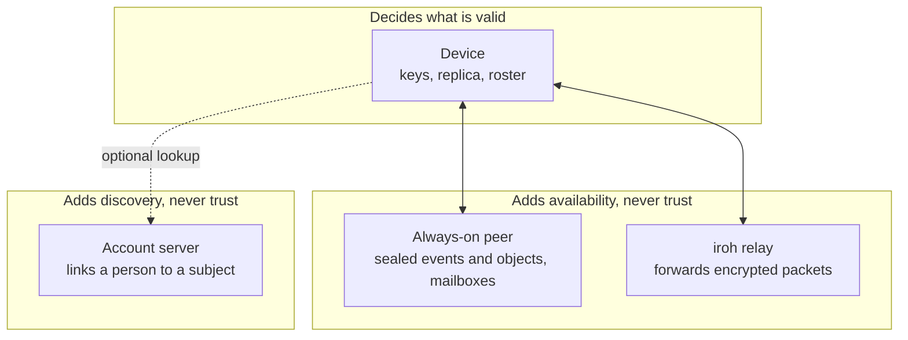
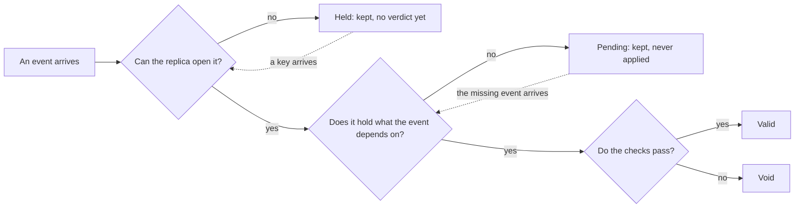
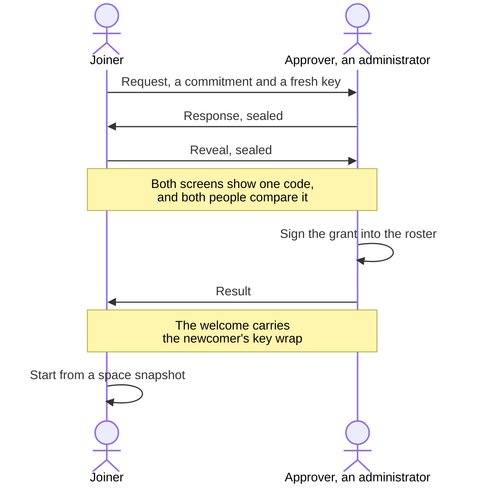
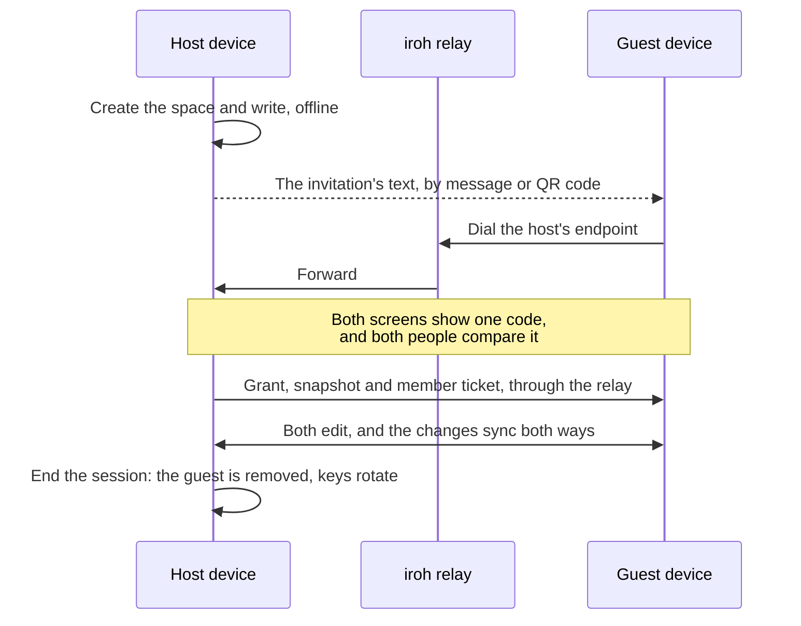
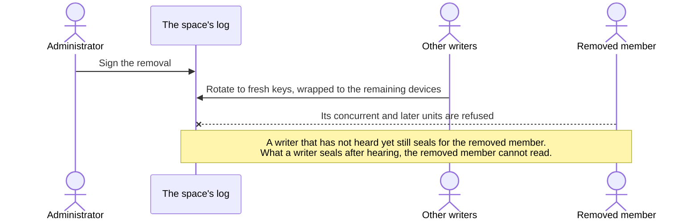
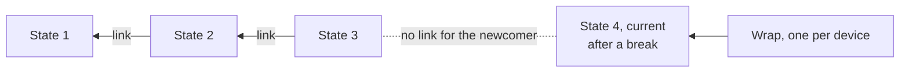
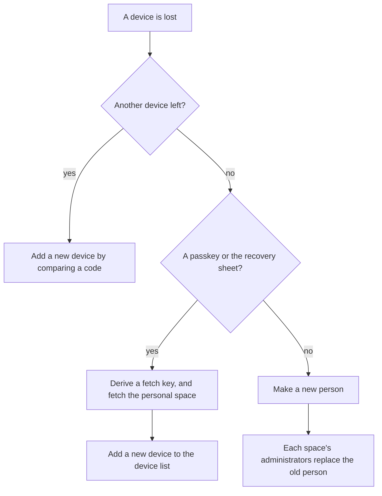

# How Frasil works

This page shows Frasil's main flows as diagrams. The
[specification](spec/README.md) is the reference: each section names the
document that defines its flow, and this page leaves out what those
documents cover in detail.

## Who holds what

A device holds its keys and a replica of each of its spaces. A peer holds
the same data, sealed, and decides no event's validity. An account is
optional and only helps people find each other.

A device has three keys: an Ed25519 key and an ML-DSA-65 key, which sign
together, and an X-Wing key, to which keys are wrapped. Its name everywhere
is its **device ID**, a hash of all three (`Device::id`, a `MemberId`), so
no record can attach another key to a device: other keys give another ID.
A device takes anyone's keys from any source, and uses them only where they
hash to the ID or commitment it checks. Show and compare devices by their
ID, never by an Ed25519 key, which names nothing. See
[crypto.md](spec/crypto.md), "A device's keys".



See [overview.md](spec/overview.md), "Threat model".

## What a peer sees

| A peer sees | A peer never sees |
|---|---|
| Space IDs and stream IDs | Content, names and adapter types |
| Sizes and timing | Members, levels, capabilities and labels |
| Which devices write, and how often | Device lists |
| How often keys change | Who a wrapped key is for |
| Which objects units reference | Which device is reading |
| Administrators, under pseudonyms | Who holds a pseudonym, with the exceptions the overview lists |

See [overview.md](spec/overview.md), "What each party sees".

A writer can ask the peers to stop keeping a stream: `Space::release_stream`
(or `Document::release`, or `Space::release_documents` for every document of
a space, such as a restricted space whose documents the application drops for
good) signs a release that every peer and member receives. Peers then answer
`released` (410) for the stream, refuse its new units, stop counting its
bytes, and delete them after their `release_retention`. The device keeps what
it holds and writes nothing in the stream (`Error::Released`) until a writer
calls `Space::restore_stream` or `Document::restore`. See
[peers.md](spec/peers.md), "Release and restore".

A release is how an application deletes a document for good. Peers erase
nothing narrower than a whole space: `Space::erase`, for an administering
device, erases the whole space at its peers once its administrators have
acknowledged the erasure or the peer's erasure timeout has passed. When a
peer reclaims a released stream, it keeps the units that events outside the
stream name, as events without content, so that every member still places
what names them.

After dropping an erased space, the device keeps a keyless residue and asks
its saved peers again until each answers `erased`, or the application gives
it up. A peer that still holds the erasure late sends its cut, checkpoint
and slot standing. The device checks the signed evidence without content
keys and reports it immediately. If the slot is still listed, it requests
a welcome from the saved administrators, fetches a snapshot and judges the
checkpoint before erasing again or reporting the erasure void. If the slot
is absent, it reports that it can no longer erase the space at that peer.
See [checkpoint and erasure events](checkpoints.md).

## How an event is judged

Everything Frasil signs and syncs is an event. Each replica judges each
event from the events it holds, so replicas that hold the same events reach
the same state, in whatever order they received them. No check reads a
clock.



A unit the write rule rejects is refused and kept, because a later merge can
void the event that refused it. See [events.md](spec/events.md) and
[roster.md](spec/roster.md).

## Joining a space

Admission is one roster event. Here it rests on a six-digit code that both
people compare. The joiner commits to its side before the approver answers,
so a relay of the exchange gets one guess at the code. The messages travel
through a mailbox at a peer, over a nearby connection, or both.



Invite links and lookups through an account are the other ways in. A lookup
is shown as unverified until a code is compared. A device that is already a
direct member of another space can be admitted from that space's roster,
with no code ([below](#admitting-a-member-of-another-space)). See
[admission.md](spec/admission.md).

## Administrators and their ranks

Every administrator holds a rank, 0 to 255, and the space's creator holds
255. A larger rank outranks a smaller one: nobody changes or removes an
administrator of a higher rank, nor makes one above their own rank, and
when two administrators remove each other at once the higher rank stands,
between equal ranks the more senior. A device is made an administrator
only at a rank its caller names: `Space::raise`, `Space::admit_administrator`
or `Engine::grant_administrator`, and a batch grant takes one too. Nearby
admission carries no rank: it admits at most `write`, and a raise follows.
Name the ranks in the application, keep the top rank on few, well-guarded
devices, and set up a recovery member at the top rank. See
[Checkpoints](checkpoints.md#ranks) for what a lost or stolen top-rank
device does.

## Administrator access to many spaces

An application that already authenticated a device can grant it further
spaces by its device ID instead of comparing a new code for each space: the
ID commits to the device's keys, so each grant carries the same keys, and
what authenticates the device is how the application learned its ID. Keep
one space where that device is a direct member, and select it by its
previously authenticated `MemberId`, never by a display name. If the device
has no direct grant yet (including access through a person alone), admit it
to one target space with the ordinary code API first. Use that space as
`known_space` and batch the remaining targets; only that first admission
compares a code.

```rust,ignore
let reports = owner.admit_spaces_via_peer(
    peer_url, known_space, device_id, &project_spaces,
    |report| show_progress(report),
).await?;
let delivered: Vec<_> = reports.iter()
    .filter(|report| report.result.is_ok())
    .map(|report| report.space).collect();
let received = recipient.receive_spaces_via_peer(
    peer_url, owner_id, &delivered, |report| show_progress(report),
).await?;
```

This grants new members `Administer` with history; existing members are
promoted and retain their original history boundary. The sender reads the device's keys
once, and checks its own authority separately in each target space. Each
roster grant is atomic. A report's `granted` says whether it committed;
`result` says whether the peer took the grant and sealed welcome. A failure
of delivery can follow a committed grant. Retry failed or unfinished spaces
after reconnecting, including ones whose grant committed: an existing member is promoted or receives another
key delivery. Other spaces continue after a failure.
Success at the sender does not mean the recipient has collected the welcome.

The receiver takes only expected spaces from the selected authenticated
approver, then checks each grant against its own keys and resolved roster.
It reports each space independently, and can collect again from the start
after a dropped connection. Missing welcomes time out after 60 seconds;
fetching a delivered space has its own 60-second deadline. A peer's mailbox
retention still applies: after expiry, the sender repeats the grant and
welcome. The application supplies the expected identities and space IDs
through its existing authenticated context. The API exchanges ordinary
roster grants and sealed device-mailbox welcomes, with no new wire format.

## Admitting a member of another space

An administrator can admit a device that another space it holds grants
directly, by the device's ID, with no code compared and no peer: the grant
carries the keys that the other space's roster names, which the ID commits
to. Only the device that holds those keys opens its welcome.

```rust,ignore
// `known` grants `device_id` directly; `space` is the one to admit it to.
space.admit_member(known.id(), device_id, Level::Write).await?;
space.admit_member_administrator(known.id(), device_id, rank).await?;
```

- The grant commits at once, offline, with history, and records `via` as
  `none`: no code was compared for it.
- The device's welcome goes over a member connection between this device
  and that one, such as the connection the two hold for the known space,
  and the device follows the space as it follows a person's grant. Only
  the device that signed the grant hands its welcome over; another member
  does not carry it. With a peer, the welcome also goes to the device's
  mailbox there.
- If the device is not connected, the welcome waits until it is. If this
  device restarts first, it makes the welcome again when the two meet,
  from the space's log and a fresh key delivery. The welcome stops being
  offered once the device has attached the space, or once it is removed
  from the space.
- It refuses a device that the known space reaches only through a person,
  a guest there, a device the space has already, and, for a restricted
  space, a device its parent does not reach. A rank is at most the
  caller's own.

What the grant proves is only that some administrator of the known space
granted that device ID. So an application that mirrors the known space's
device members into another space gives the known space's administrators
the power to admit to the other one. And a removal from the known space
does not reach the other space: the application mirrors removals itself,
with `Space::remove` in each space it mirrored the device into.

## Collaborating with no peer

Two people can work on a space together with no always-on peer, across
the internet, through an iroh relay that both devices name. The relay
forwards sealed QUIC packets and keeps nothing.



- The application names its relays (`Options::relay`). Frasil names none,
  and a device with no relay reaches others only on its own network.
- On one local network, devices with `Options::local_discovery` need no
  relay either. Each announces the spaces it holds, four every 2 seconds
  in turn: with N spaces, a space is announced every ceil(N / 4) × 2
  seconds. A device that can read another's announcement dials it, and
  their connection then carries every space the two share.
- Changes move only while both devices are connected:
  `Space::connected_members` says who is connected now. An always-on peer
  is what keeps changes for someone who is away.
- Devices reconnect at the member tickets they kept until both member
  endpoint keys have rotated, which happens daily and at each new network.
  After that, one of them sends a fresh invitation.
- A browser reaches other devices only through an always-on peer: the
  browser package has no iroh binding.
- Sharing one document of a larger space works the same way: carve the
  document out (`Document::carve_out`) and invite the guest into the space
  it moved to.

## Removing a member

A removal is strict for writes: replicas refuse the member's later units and
its concurrent ones. It is eventual for reads: it protects what writers seal
once they have heard of it.



The removal rotates the space's keys, and the removed device never receives
the new key. So the removal also carries, among its wraps, one sealed to each
removed device that holds only that event's body key. The removed device
opens the removal with it, resolves a roster without itself, and reports it:
`Space::level` is `None`, `Space::members` no longer lists it, and
`Device::events` gives `Event::Removed` (`"removed"` in the browser package).
An application can then drop what it cached from the space, and
`Space::forget` deletes the device's copy.

An administering device leaves with `Space::leave`: it removes its person,
when its person is a member, then itself, and forgets the space once a peer
holds the removals. A self-removal does not rotate, since the leaver would
hold the new key; another writer heals. A member that does not administer
sends a leave request to the administering devices instead, with the
guests extension, or asks an administrator to remove it.

A removed member keeps everything it already received. When a space loses a
device, each space that inherits the loss through a grant rotates in a
cascade. See [roster.md](spec/roster.md) and [keys.md](spec/keys.md).

## Checkpoints

Membership history grows with every change. A checkpoint fixes the
membership at one point of a space's log; once every administrator has
written after it, it takes effect, and members forget what came before it.
Devices propose, vote for and forget under checkpoints by themselves,
whether or not the space has an always-on peer: members carry what a
checkpoint needs to each other. A few outcomes need a person: a checkpoint
waiting for an administrator who will not return, which a member that
outranks it, or a recovery member, unblocks by removing or demoting it;
membership changes that came too late and must be made again; an erasure
or a release made too late, which the device signs again and reports; and
a checkpoint the device keeps out of. See
[Checkpoints](checkpoints.md) for what an application shows, and
[roster.md](spec/roster.md), "Checkpoints". A device reads a space's checkpoint record as the record's chunks open, without holding the whole record. A device that already holds the checkpoint's past keeps only a digest of it: for a record near its 256 MiB cap (roughly 80,000 member devices), the read took about 5 seconds natively and 11 to 16 seconds in a browser on a recent laptop, in under 10 MB. A device that starts from the checkpoint keeps the record's members, about 320 MB for that record in the read alone, so a very large space still needs a device with that much memory to join it.

## How keys change

A space's keys form a graph of states. Each rotation draws fresh secrets. A
link seals an earlier key under a later one, so that a holder of the later
key reaches the history. A member granted from now on starts after a break,
with no link back.



Where a link cannot hang, because a possible holder is not entitled to what
it reaches, entitled members receive the earlier key by wrap instead. See
[keys.md](spec/keys.md).

## Coming back after losing a device



A person who still has a device, a passkey or the recovery sheet then revokes
the lost device from the device list. The recovery agent
extension adds one more route, with a waiting period the person can veto.
With the `ext-recovery-agent` feature, a device names an agent with
`Device::name_agent`, from the keys and proof the agent returns
(`AgentKeys::new`), and gives the agent the returned list events. The agent
signs its proof for the device that names it, so it needs that device's ID
(`Device::id`) with the person ID and the personal space ID; a
device the agent later adds signs its proof for the agent in the same way.
`Space::agent_policy` and `Device::spaces_forbidding_agents` say which spaces
forbid agents, which the person is told before naming one, and
`Device::veto` revokes a device an agent added (`Event::AgentAdded`). See [identity.md](spec/identity.md) and
[ext-recovery-agent.md](spec/ext-recovery-agent.md).

## Writing straight after opening

A device opened from a store that may have been restored from a backup
could hold an older copy of its own chain. If it signed from there, it
would give a new event a sequence number it had already used, and the
other replicas would hold two events at one place: a fork, which voids the
device from that point on. So a device that opens as restored signs in a
space only once it has fetched its own newest events there from a peer or
a member, and until then every write in that space fails with
`Error::SyncBeforeWriting` (`sync_before_writing` in the browser package).

Whether a device opens as restored follows from its restore mode (`Options`;
see [at-rest.md](spec/at-rest.md), "Continuity"):

| Restore mode | Opens as restored |
|---|---|
| `device-bound`, with a slot that no backup restores | when the store is older than the slot says, as after a restore, or after a crash between the two |
| `never-restored` (the browser's default) | never |
| `none` (the default for `Storage::directory`) | at every open |

A write straight after opening can therefore be refused. Wait for the
device to sync the space before writing, or retry on the error:

```rust
let device = Device::open(Storage::directory(&dir), &unlock_key).await?;
device.connect("https://peer.example.org").await?;
let space = device.space(space_id).await?;
space.wait_write_ready(Duration::from_secs(30)).await?;
let note = space.document(note_id).await?;
note.edit(|doc| doc.get_text("body").insert(0, "Hello")).await?;
```

- `Space::is_write_ready` says whether the device may write there now.
- `Space::wait_write_ready(within)` returns at once when it may, and
  otherwise once the device has synced the space on its connections. It
  fails with `SyncBeforeWriting` when that takes longer than `within`, as
  when no peer or member that holds the space is reachable.
- `Space::observe_write_ready` is the same answer as an observed value,
  for a screen that disables editing until it is `true`, and
  `Event::WriteReady` reports each space as it becomes writable.

In the browser package these are `space.isWriteReady()`,
`space.waitWriteReady(withinMs)`, `space.observeWriteReady()` and the
`writeReady` event; in the Swift and Kotlin bindings, `isWriteReady`,
`waitWriteReady(withinMs)` and `observeWriteReady(listener)`. The device
may read, and receive changes, the whole time; only its own writes wait.

When another pseudonym holds this device's administrator slot, `SlotHeld`
(`slotHeld` in JavaScript) names the space and holding root or enrolment,
identifies the holder as another installation of this device, another device,
or unknown, and says whether this device's erasure waits on it. A residue
has no keys and reports unknown. It keeps asking peers, without requesting
a welcome for a slot the cut names as held. Use the other installation to
administer, or ask another administrator to disown the slot and grant a new
one. An occupied slot cannot be enrolled again.
