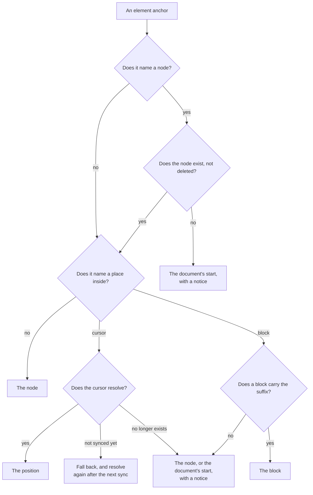
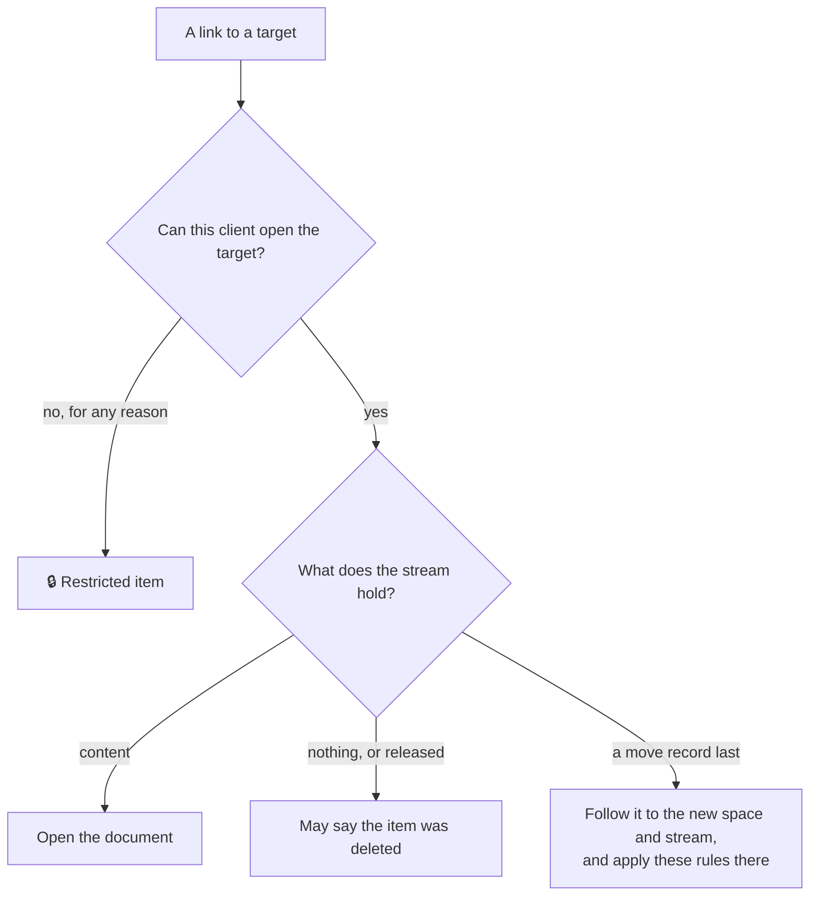

# Links and anchors

A link names a document in a space, and optionally a place inside it: an element of a
structured document, a position or a block in a text, a passage of a PDF. Links are written
inside encrypted documents, so only someone who can read the document holding a link can see
it, and only someone who can read the target can follow it. This page is the format; a parser
and formatter of it test against the examples below.

Spaces are [overview.md](spec/overview.md)'s, streams are [units.md](spec/units.md)'s, and
moved documents are [ext-restricted-spaces.md](spec/ext-restricted-spaces.md)'s.

## Shape

```text
example://<space>/<stream>#<kind>:<body>
└──┬──┘   └──┬──┘ └──┬───┘ └────┬─────┘
scheme    optional required  optional anchor
```

- **Scheme** is chosen by the application; see [The scheme](#the-scheme).
- **Space** is the space's ID, the event ID of its first event
  ([events.md](spec/events.md), section 4.4), as 64 hexadecimal digits. It is **optional**:
  `example:///<stream>` (three slashes, an empty authority) means the space of the document the
  link is written in. Clients write the short form for every link within one space, so that
  links inside a space do not repeat its ID, and a copy of a whole space that keeps its stream
  IDs keeps its internal links.
- **Stream** is the document's stream ID in that space ([units.md](spec/units.md), section
  2.6), 16 bytes, as 32 hexadecimal digits. An application that maps several documents
  to one stream names a document inside it with an anchor of its own kind.
- **Anchor** is optional. Without one the link names the whole document.

A space is named by its ID alone, never by a path of spaces. A space can be reached through
several grants ([roster.md](spec/roster.md), section 3.3), so a path is not unique, and it would
show a reader of the link how spaces nest.

A link never carries the target's name, title or kind. Those are encrypted, and a link must
not reveal them to a reader who can see the link but not the target.

### The scheme

There is no fixed scheme. An application chooses the scheme its links are written under, and
applications that link into each other's documents agree on one scheme between them. A scheme
is 1 to 32 bytes (`MAX_SCHEME_BYTES`): a lower-case letter, then lower-case letters, digits,
`+`, `-` or `.`, which is RFC 3986's scheme syntax in lower case (`valid_scheme`).

`Link::parse(scheme, text)` takes the scheme the application expects. It answers
`LinkError::Scheme` when that scheme is not valid, or when the text does not start with it
followed by `://`. The scheme is matched without regard to case, kept in the parsed `Link`,
and written in lower case by `Display`.

Frasil registers nothing with the operating system and resolves nothing. What opens a link
clicked outside an application is whatever that application registered for its scheme.

An application that uses the same scheme for other URLs, such as a sign-in callback
(`example://auth/callback`) or an invite hand-off, must make sure they do not parse as links,
or give them a separate scheme. `example://auth/callback` is refused, since `auth` is not a
space ID and `callback` not a stream ID (`LinkError::Shape`), but any URL under the scheme
with an empty or 64-digit hexadecimal authority, one path segment of 32 hexadecimal digits and
no query is read as a link when it has no fragment, or a fragment that is a valid anchor.

## Grammar

In ABNF (RFC 5234), with `ALPHA`, `DIGIT` and `HEXDIG` from its core rules and `unreserved`,
`pct-encoded` and `sub-delims` from RFC 3986:

```abnf
link        = scheme "://" [ space ] "/" stream [ "#" anchor ]
scheme      = LOWER *31( LOWER / DIGIT / "+" / "-" / "." )
                                            ; any case on input, lower case when written
space       = 64HEXDIG                      ; a space ID, 32 bytes
stream      = 32HEXDIG                      ; a stream ID, 16 bytes, not all zero
                                            ; both: any case on input, lower case when written

anchor      = kind ":" body
kind        = 1*LOWER version               ; at most 16 bytes: "e1", "pdf1"
version     = "0" / ( %x31-39 *DIGIT )
LOWER       = %x61-7A
body        = e1-body / pdf1-body / other-body

e1-body     = node [ "/" within ] / within
node        = number "@" number             ; Loro counter "@" peer
within      = "c." cursor / "b." block
cursor      = 2*( ALPHA / DIGIT / "-" / "_" )   ; base64url, no padding
block       = 6( %x32-39 / %x61-6B / %x6D-6E / %x70-7A )
                                            ; 2-9, a-z without l and o

pdf1-body   = node ";p=" page [ ";q=" quote ] [ ";r=" region ]
page        = %x31-39 *DIGIT                ; 1 to 4294967295
quote       = 1*( unreserved / pct-encoded )
region      = fraction "," fraction "," fraction "," fraction
fraction    = "0" / "1" / "0." *3DIGIT %x31-39

other-body  = *( unreserved / pct-encoded / sub-delims / ":" / "@" / "/" / "?" )
number      = "0" / ( %x31-39 *DIGIT )
```

The application supplies the expected `scheme`; a link under any other scheme is refused. No
other character may appear. There is no query (`?` before the `#`), no user or port, and no
second path segment; a trailing slash is a second, empty segment and is rejected.

### Percent-encoding

A space or stream ID is hexadecimal and never needs escaping. Every quote is UTF-8 in which
each byte outside `unreserved` (`A`-`Z a`-`z 0`-`9 - . _ ~`) is written `%XX`. A space is `%20`,
never `+`; an `é` is `%C3%A9`. Raw non-ASCII (an IRI) is not a link. Because a written link
holds only unreserved characters, `%`, and the anchor's own delimiters, it can be put in a
Markdown link destination or angle brackets without escaping.

### Limits

| Part | Limit |
| --- | --- |
| Whole link, as written | 4096 bytes |
| Space | 32 bytes, as 64 hexadecimal digits |
| Stream | 16 bytes, as 32 hexadecimal digits; never 16 zero bytes ([units.md](spec/units.md), section 2.6) |
| Anchor kind | 16 bytes |
| Cursor | 1 to 256 bytes decoded |
| Quote | 1 to 512 bytes decoded, after whitespace is collapsed |
| Page | 1 to 4294967295 |

Control characters (Unicode category Cc: U+0000 to U+001F, U+007F to U+009F) are rejected in
every decoded part, including the body of an anchor kind the reader does not know. Space and
stream IDs are fixed-length hexadecimal, so neither can be empty, a dot segment, or hold a
character a URL library rewrites.

## Anchors

An anchor's kind is a name and a version: `e1` is version 1 of the element anchor, `pdf1`
version 1 of the PDF anchor. A body of a known kind is closed: a parameter that version 1 does
not define makes the anchor invalid. Anything new is a new version (`pdf2`) or a new name, so a
reader never half-understands an anchor.

A reader that meets a kind it does not know keeps the link, opens the document without the
anchor, and preserves the anchor text byte for byte (`Anchor::Unknown { kind, raw }`). It never
rewrites or drops it.

### Element anchor, `e1`

The body names a node, a place within a node, or both:

| Body | Names |
| --- | --- |
| `e1:<counter>@<peer>` | A **node**: an element of a structured document, identified by its node ID: a Loro tree node (`TreeID`), or the Loro `ID` of the operation that created a list or map element. Written exactly as Loro formats an `ID`, so `TreeID::try_from` reads it. |
| `e1:c.<cursor>` | A **position** in a Loro text: the bytes of `loro::cursor::Cursor::encode`, in base64url without padding. The cursor names its own container. |
| `e1:b.<block>` | A **block** of text, by its block suffix: six characters from the alphabet `23456789abcdefghijkmnpqrstuvwxyz`, written in the text after a `^` (`^k7f3qa`) and in the anchor without it. |
| `e1:<node>/c.<cursor>`, `e1:<node>/b.<block>` | A position or block within that node, with the node as the fallback when the inner part no longer resolves. |

Which one to write:

- **An element of a structured document**, such as a catalog entry: the node. It is stable
  for the life of the element in the document's history, through edits, renames and moves.
- **A span of text**: the node holding the text and a cursor. A cursor is precise but belongs
  to one Loro history: if the text is replaced wholesale, for example by importing a file an
  outside editor rewrote, the cursor stops resolving and the link falls back to the node.
- **A block of text**: the node holding the text and the block's suffix. The suffix is written
  in the text, so it survives outside editors, file round trips and rewording. Linking a block
  stamps a suffix on it if it has none. The node qualifies the suffix, because suffixes are
  unique within one text but not across a document.

#### Resolving an element anchor

A client resolves against the replica it holds and never guesses an offset another way.



1. **Node.** If the node exists and is not deleted, the target is the node. If it was deleted,
   or moved to the trash, the target is the document, opened at its start with a notice that the
   element was removed.
2. **Cursor.** Decode it and ask Loro for its position (`LoroDoc::get_cursor_pos`).
   - Resolved: go there. If the character the cursor was attached to has since been deleted,
     Loro returns the position where it stood, which is the nearest surviving position, and that
     is the target. This is what "stale" normally means, and it needs no special handling.
   - The operation is not in the replica yet (Loro's `IdNotFound`): the link is newer than this
     replica's copy of the target. Fall back to the node, or the document's start, and resolve
     again after the next sync.
   - The container was deleted, or the history before a shallow snapshot was cleared
     (`ContainerDeleted`, `HistoryCleared`), or the cursor's container is not a text of the
     named node: fall back to the node's start if there is a node, else the document's start,
     with a notice that the position no longer exists.
   - Loro may return an updated cursor with the position. A client may write it back only when
     the author is editing that link anyway. Following a link never edits the document holding
     it: a viewer could not, and every reader rewriting links would create edits nobody made.
3. **Block.** Look for a block carrying the suffix, within the node if there is one, else in
   every text of the document; a suffix is an alias, so a block carrying several suffixes
   matches any of them. If none carries it, fall back to the node, or the document, and say the
   block was not found.

### PDF anchor, `pdf1`

```text
pdf1:<entry>;p=<page>[;q=<quote>][;r=<x>,<y>,<w>,<h>]
```

- **Entry** is the node of the element that holds the PDF, such as an entry of an
  `example.assets` catalog, which pins one content revision of the file. A PDF is not itself a
  document, so the anchor must say which of the document's files it means.
- **Page** counts from 1, as PDF viewers number pages for a reader, not as the file's page
  labels (`iv`, `A-3`) do.
- **Quote** is the passage's text as the viewer extracted it, with every run of whitespace
  collapsed to one space and the ends trimmed. The parser collapses it, so two links that differ
  only in spacing are the same link. It is optional, but a writer includes it whenever the
  selection has text: it is what finds the passage again after the PDF is replaced.
- **Region** is a rectangle on the page as displayed (after the page's `/Rotate`), measured from
  the top left of its crop box, as fractions of the page's width and height: `x`, `y`, width,
  height. Each fraction is `0`, `1`, or `0.` and at most four decimals with no trailing zero
  (`0.25`, never `0.250` or `.25`). Width and height are positive, and the rectangle stays on
  the page. It is optional: without it the anchor is the quote on the page, or the whole page.

Parameters appear in that order, each at most once.

#### Resolving a PDF anchor

1. Find the entry, as a node. If it is gone, fall back to the document.
2. Open the revision the entry pins now. If the page exists and, when there is a quote, the
   page's collapsed text contains it, the target is that page, at the region if there is one,
   else at the quote's first occurrence (or the occurrence overlapping the region, if both).
3. Otherwise, when there is a quote, search the other pages in order of distance from the
   stated page, nearest first, earlier before later on a tie, and take the first page whose text
   contains it. The region is then dropped, since it measured another layout.
4. If the quote is found nowhere, or there is none and the page no longer exists, open the
   nearest existing page and say the passage was not found in this version.

Matching compares collapsed text exactly, case and punctuation included. Anything looser is a
guess, and a wrong passage presented as the right one is worse than a notice.

## Equality and normalisation

`Link::parse` accepts exactly the grammar above, and `Display` writes the **canonical form**:

- the link's own scheme, in lower case;
- the space and stream IDs in lower-case hexadecimal;
- every byte of a quote outside `unreserved` escaped with upper-case hex, and nothing else
  escaped;
- numbers without sign or leading zeros; fractions in their shortest form; PDF parameters in
  their fixed order; a quote's whitespace collapsed; cursors in unpadded base64url with zero
  trailing bits.

Parsing accepts three spellings the canonical form does not use, because RFC 3986 makes them
equivalent or a URL library may produce them: the scheme in any case, the space and stream IDs
in any case (a URL library may change the case of a host), and percent-encoding in a quote in
lower-case hex or of a character that needs none (`%61` for `a`). Everything else has exactly
one spelling.

Two links are **equal** when their parsed values are equal, scheme included, which is when
their canonical strings are equal. A link without a space is compared after filling in the
space of the document holding it (`Link::resolve`), so `example:///<stream>` in space `S`
equals `example://S/<stream>`. An unknown anchor compares byte for byte. Two anchors that happen to land on
the same place (a node, and a cursor inside it) are different links. Clients store and compare
links in canonical form, and rewrite a link to it when the author edits the link.

## Storage

A link is stored as its canonical string, inside the encrypted document that holds it:

- In a text, as ordinary Markdown: `[the text the author wrote](example://…)`, or
  `<example://…>` for a bare link. The Loro text holds these characters like any others, and a
  Markdown file projected from the text carries them unchanged.
- In a structured document, such as an asset catalog, as a string value in the element's Loro
  map, under a field that document kind defines, such as an element's reference to a block of
  text.

**Why a string and not a structured node.** A structured link (a Loro map with `space`,
`stream` and anchor fields, embedded in the text) was considered. It would make links
impossible to mistype, but it would tie every document kind to one schema, and disappear from
a Markdown projection of the text or turn into something only one application reads. As a
string, a link stays visible plain text, and the text still reads without the application
that wrote it. A string in the text costs one thing: a link can be malformed while someone is
typing it, or after two people edit it at once. A malformed link renders as the text it is, and nothing else depends on it. The Rust type is
the parser for that string, not a storage format.

Links are content. They are encrypted with the document, are never copied into plaintext
metadata, and no always-on peer ever parses, indexes or rewrites one.

## Backlinks

Backlinks are computed on the client. A client scans the documents it can decrypt, extracts
every link under its scheme (Markdown link destinations and autolinks in texts; the link
fields a structured kind defines), resolves each against the space of the document holding it, and
indexes it by target document and anchor. The index is derived local state, like the search
index: rebuilt from content, never synced, never sent to an always-on peer or to members, and
never turned into a request that names a target. A backlink from a document the viewer cannot
decrypt does not exist for that viewer; counts and lists cover only what the viewer can read.

Links in both directions come from this. An element of a structured document stores a link to
a block of text, and the block shows the element among its backlinks to anyone who can read
the structured document. The text need not store a link back.

## Rendering

A client can **open** a target when it is a member of the target space, holds the keys of the
states the stream's units name, and holds (or can fetch as a member) the stream. It decides
this from what it already has, its effective membership ([roster.md](spec/roster.md),
section 3.3) and its keys, and never asks a peer about a space it is not a member of, since a
different answer for "missing" and "forbidden" would itself be a leak.



When it cannot open the target, for any reason (not a member of the space, removed from it, no
key for the state, or no such space), the target renders exactly as:

```text
🔒 Restricted item
```

- The text is that string: U+1F512, a space, `Restricted item`, localised as a whole but never
  varied by reason. The reasons are indistinguishable on purpose.
- Nothing about the target is shown: no name, no kind, no icon by kind, no size, no preview,
  and no hint of whether it exists. The anchor's details (page, region, quote) are not shown
  either.
- **The link text the author wrote is shown as written.**
  `[Act 2 lighting notes](example://…)` still reads "Act 2 lighting notes", with the restricted label where the target's title, preview or
  hover card would be. A bare link, which would have shown the target's title, shows only the
  label.
- Following it opens nothing and makes no request; it may explain that the item is in a space the
  viewer is not a member of.
- In a backlink list, a source the viewer cannot read is absent, not restricted.
- The source view shows the link as stored, which is what the author wrote.

When the viewer is a member of the space but the stream holds nothing, or was released
([units.md](spec/units.md), section 3.12), the client may say the item was
deleted, since a member learns that anyway. When the stream's last unit is a move record
([ext-restricted-spaces.md](spec/ext-restricted-spaces.md), section 2.4), the client follows it to the document's new space
and stream, and renders the target there by the same rules; it rewrites the stored link only
when the author edits it. Inside a document the viewer can read, a missing element or passage
falls back as described under each anchor.

**What a link itself reveals.** The IDs and the anchor are readable by everyone who can read
the document holding the link. A space ID is a hash and a stream ID random; neither says what
the target is called. They do say which space holds the target, and a stream ID is visible to
the always-on peers of its space with that stream's sizes and timing
([overview.md](spec/overview.md), section 4.1), so a reader who also watches a peer can tell which
stream the link names. A PDF quote is content: linking from a space into a narrower one (from a
project into a restricted space under it) would show that passage to readers of the wider
space. A client writing a quote-bearing anchor into a document whose space is not the target's
asks the author first and offers the anchor without its quote.

## Worked examples

The space is `3382737ee74be97447a55cc11237b22d288cd64901a52eb06d6043181af74c31`; within the space, links omit it.

**A block of text.** In the `example.script` document whose stream is `01bdb95c0b0989d1364ba8d9f7f24910`, the
text is held by the node `3@9431287310442` and the block carries the suffix `^k7f3qa`:

```text
Nothing to be done. ^k7f3qa
```

```text
example:///01bdb95c0b0989d1364ba8d9f7f24910#e1:3@9431287310442/b.k7f3qa
```

**A span of text.** Character 10 of the same text, as a Loro cursor (21 bytes: the
character's operation `15@9431287310442` in the text container `4@9431287310442`):

```text
example:///01bdb95c0b0989d1364ba8d9f7f24910#e1:3@9431287310442/c.AerQnqS-kgIeAerQnqS-kgIIAAEK
```

**An element of a structured document.** Node `204@1188300291` in the `example.show` document
whose stream is `6335b4532aefaca4110c84334a23d534`, as another document links to it:

```text
[GO LX 14](example:///6335b4532aefaca4110c84334a23d534#e1:204@1188300291)
```

**An asset.** The catalog entry `57@600318842` in the space's `example.assets` document, stream
`1c33bf6d7463346fe528f915473744a5`:

```text
example:///1c33bf6d7463346fe528f915473744a5#e1:57@600318842
```

**A PDF passage.** Page 12 of that entry's PDF, the passage "To be, or not to be", in a band a
twentieth of the page tall, a quarter of the way down:

```text
example:///1c33bf6d7463346fe528f915473744a5#pdf1:57@600318842;p=12;q=To%20be%2C%20or%20not%20to%20be;r=0.1,0.25,0.8,0.05
```

**A document in another space.**

```text
example://1134abb98c374d5daf5c4eb260e3b578a32da70bfde9ee7760c8e5fe6d289958/d2103de5a92f9d7c33bdeb109d2362c1
```

**Accepted and rewritten.** `EXAMPLE://1134ABB98C374D5DAF5C4EB260E3B578A32DA70BFDE9EE7760C8E5FE6D289958/D2103DE5A92F9D7C33BDEB109D2362C1` parses as the link above
and is written in lower case.

**Rejected.** `https://…` and `example:/d2103de5a92f9d7c33bdeb109d2362c1` (scheme); `example://3382737ee74be97447a55cc11237b22d288cd64901a52eb06d6043181af74c31` and
`example:///d2103de5a92f9d7c33bdeb109d2362c1/` (shape); `example:///v7Kq2/main` (not hexadecimal IDs); `example:///d2103de5a92f9d7c33bdeb109d2362` (a stream of 15 bytes); `example:///00000000000000000000000000000000` (the
reserved stream); `example:///d2103de5a92f9d7c33bdeb109d2362c1?x=1` (query); `example:///d2103de5a92f9d7c33bdeb109d2362c1#` (empty anchor);
`example:///d2103de5a92f9d7c33bdeb109d2362c1#e1:03@4` (leading zero); `example:///d2103de5a92f9d7c33bdeb109d2362c1#pdf1:3@4;p=0` (page 0);
`example:///d2103de5a92f9d7c33bdeb109d2362c1#pdf1:3@4;p=1;r=0.50,0,0.5,1` (fraction not in shortest form);
`example:///d2103de5a92f9d7c33bdeb109d2362c1#pdf1:3@4;p=1;q=caf%C3%A9%0A` (control character).

**Kept but not understood.** `example:///1c33bf6d7463346fe528f915473744a5#pdf2:57@600318842;p=12;hash=abc` parses
as `Anchor::Unknown { kind: "pdf2", raw: "57@600318842;p=12;hash=abc" }`; a client that does
not know `pdf2` opens the document and leaves the link as it is.

## Not covered

- A link to a document that moved, for a reader who cannot open the original stream. A move
  leaves a move record in the original stream
  ([ext-restricted-spaces.md](spec/ext-restricted-spaces.md), section 2.4), which
  a reader of that stream follows; a reader who can open only the new space sees the old link
  as restricted. The author rewrites it by editing it.
- PDFs held elsewhere than as an element with a node, such as attachments keyed by name. They
  become linkable through a catalog entry.
- Time anchors into audio and video, and anchors into cells of a budget. Each is a new kind.
