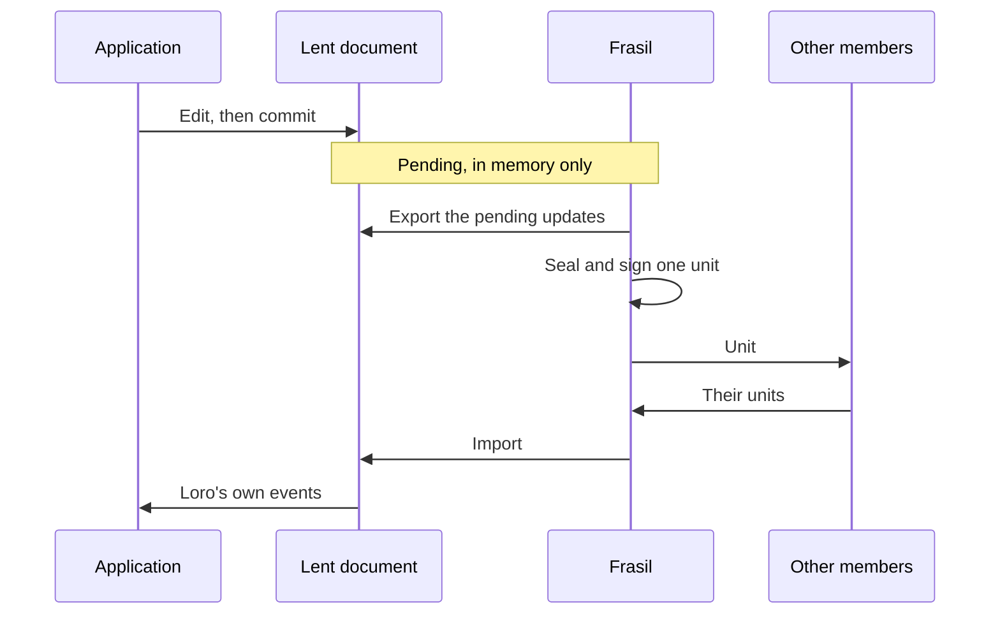
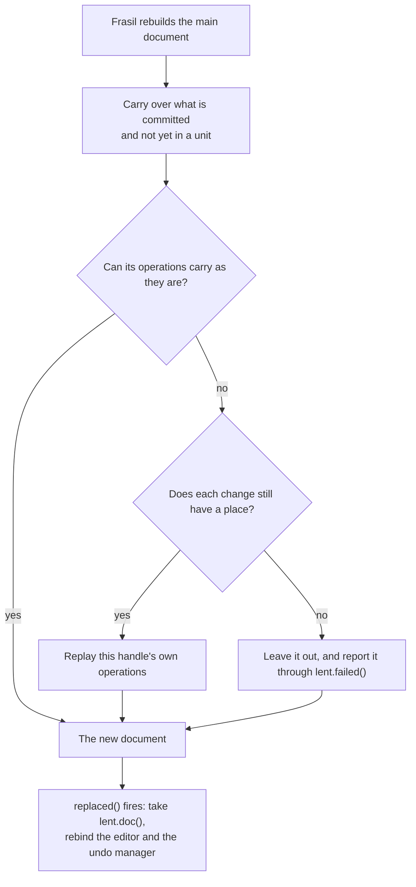

# One document: lending a Loro document to the application

A native application edits Frasil's own Loro document: `Document::lend`
hands it a reference to the replica's main document, and the
application's editor, undo manager and files work on that one document.
This page says what an application does. The browser package uses
`Live` instead: a JavaScript Loro document cannot share the Rust one.

The API is in the `frasil` crate under the `adapter-loro` feature, not on
wasm32. The module docs of `frasil::Lent` are the reference; this is the
walk-through.

## Opening

```rust
let document = space.document(id).await?;   // or space.create_document()?
let lent = document.lend().await?;
let doc = lent.doc();                        // a loro::LoroDoc
```

`doc` is Frasil's document, not a copy: `LoroDoc::clone` shares one
document. It writes under this device's fresh incarnation, which
`lent.peer_id()` names; do not change its peer ID. Edit it and `commit()`
as Loro does. Other members' operations arrive in it as Frasil applies
their units, and reach the application as Loro's own events, so subscribe
to the document for them. A document just created can be lent before its
first unit: build a new file directly in it.

One handle at a time per document and device: a second `lend` returns
`NotAllowed` until the first is dropped.

## Units

Every unit carries a signature, so Frasil batches the application's
commits.



A unit is written

- `LENT_WINDOW` (250 ms) after the first commit since the last unit,
- at once when the pending updates pass `LENT_PENDING_LIMIT` (64 KiB),
- on `lent.flush().await?`,
- when the last handle is dropped, and at `Device::close`.

Within the window the operations exist in memory only. A crash loses what
the window holds, and nothing is left to re-express: the store and the
application hold the same document. An application that keeps a file of
its own writes it after `flush()`:

```rust
lent.flush().await?;
std::fs::write(path, lent.doc().export(ExportMode::Snapshot)?)?;
```

A unit the engine refuses (the device must sync first, a rotation is due,
its level fell, the store failed) stays pending: the handle tries again
with backoff, up to `LENT_RETRY_LIMIT` between tries, and
`lent.failed()` is a watch that holds the failure until a unit is written.
`flush()` returns the same failure. Show it; the operations are not lost.
The same watch holds a change that could not be carried across a
replacement (below), until the next replacement carries clean; `flush()`
does not return that one. Such a change is left out, not tried again: a
change placed by position that fits a later text need not mean what it
meant.

Loro commits the transaction in flight whenever the document is exported
or imported, which happens at each unit Frasil writes and each one it
applies. A logical edit made in several steps can so land in two units and
two undo groups: commit it before yielding, or make it within one
transaction of your own.

## Undo

Bind Loro's `UndoManager` to the lent document once:

```rust
let undo = UndoManager::new(&lent.doc());
```

It undoes this peer's operations and no one else's, by construction.
`frasil::Undo` does the same and binds itself again whenever Frasil
replaces the document, so that the application keeps one for the
document's life ([Undo, versions and review](undo-versions-review.md)).

## Replacement

After a rebuild (a unit withdrawn by a removal learned late, a fork, a
snapshot taken) Frasil builds the main document again. The handle then
refers to the new document and tells the application:



```rust
let mut replaced = lent.replaced();
loop {
    replaced.changed().await?;
    let doc = lent.doc();                    // the new document
    editor.bind(&doc);
    undo = UndoManager::new(&doc);           // the old stack is not carried
}
```

Everything committed and not yet in a unit is carried over, and the
reference the application held before stays watched until it takes the
new one with `lent.doc()`. Operations are carried as they are when that is
exact. Otherwise this handle's own operations, and nothing of any other
member's, are replayed onto the new document: each change is applied
again where it was made, found through the elements around it. Text typed
after a removed member's insertion goes after what remains before it; a
deletion takes what the new document still shows; a mark, a counter's
step, a map key, a move and a set are this handle's own, never the
removed member's. A character typed inside the removed member's bold text
does not keep the bold it took from it. Loro records no operation for a
mark that changes nothing, so bolding text that is already bold (as the
removed member's bold made it) leaves nothing to express. A move to the
front or the end of a list lands there. What the application still commits to the old reference after
the replacement is replayed the same way: take the new document promptly.

What has no place is left out and reported through `lent.failed()`: an
operation inside something only the removed member made (a key set in its
map, a child created under its tree node, a move or a set of its list
item). It is not written as the removed member's, and it is not tried
again; the report stays until a later replacement carries clean.

When the rebuilt document no longer holds an operation this handle wrote
to a unit (the device was removed and granted again, so its unit was
withdrawn; or its unit waits inside Loro on one that was), the incarnation
is renewed: `peer_id()` changes, and what it committed that the rebuilt
document does not hold is replayed under the new one, the same way.

Each writer expresses its own operations, and only its own. Another
member's text made over this device's withdrawn text comes back through
that member's own handle, in its place without this device's text, not as
this device's edit; nothing waits on another writer coming back, and a
forked device's text never returns. So two members whose withdrawn units
held each other's text each express their own, whether the losses
arrived in one rebuild or two, and every replica reads each text once. A
writer that is not lent (one that writes with `Document::edit`) has no
handle to express its operations: they stay pending inside Loro, the
replica reports them (`LoroDependsOnRefused`), and that writer writes its
change again ([adapter-loro.md](spec/adapter-loro.md), 3.3 Merge and
rebuild).

Only a live handle expresses its operations. A device that restarted, or
dropped its handle, lends again at a fresh incarnation; if a unit of the
earlier incarnation is withdrawn after that, nothing expresses it again,
and the rebuilt document is without it. An application that must keep
such edits writes them again from its own copy.

Loro's undo manager belongs to one document: bind a new one to the new
document. Replacements are rare; the new undo manager undoes what is
written after.

## Suggestions

A suggestion is made on a fork of the lent document and stays in Frasil's
suggestion layer until a writer accepts it:

```rust
let fork = lent.doc().fork();
let from = fork.oplog_vv();
// edit the fork
lent.suggest(&fork.export(ExportMode::updates(&from))?).await?;
// later, a writer:
document.accept(&[id]).await?;
```
