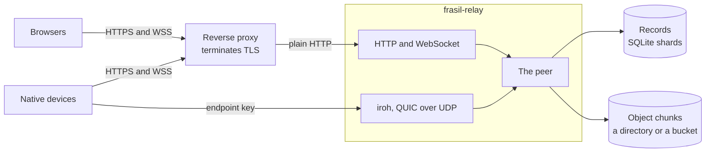
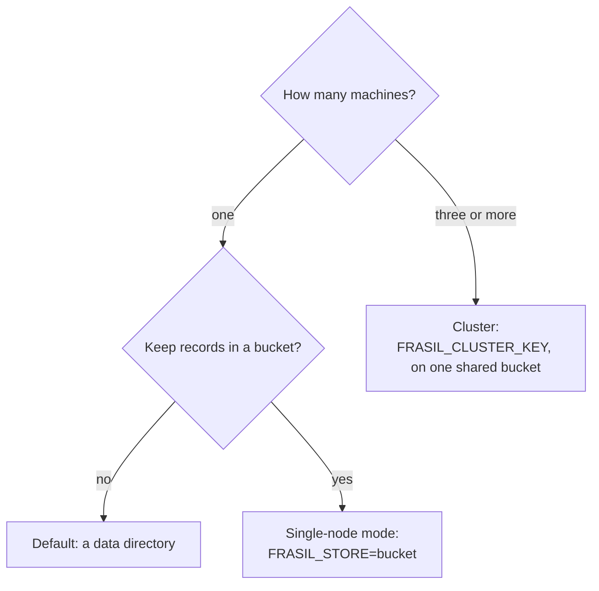
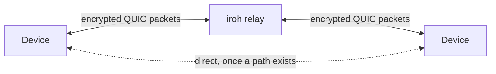
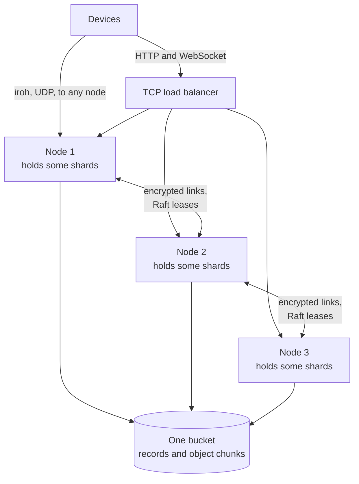
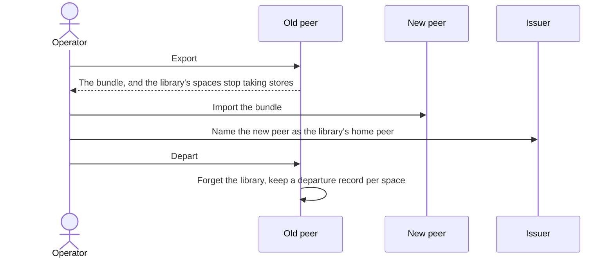

# Self-hosting a peer

`frasil-relay` (`apps/relay`) is Frasil's always-on peer. Devices keep their
spaces at a peer so that they stay available while the devices are off: it
stores the sealed events and objects they send, relays them to the other
members, and keeps mailboxes. It holds no key and reads no content. It
checks envelopes, signatures, sizes and rates, and decides only what it
stores and serves ([peers.md](spec/peers.md)).

A peer speaks two bindings ([transport.md](spec/transport.md)):

- the **server binding**: HTTP and a WebSocket, for browsers and for any
  device that reaches the peer by URL;
- the **iroh binding**: QUIC over UDP, for devices that reach it by its
  endpoint key, directly or through a relay.

It keeps its records in SQLite and its object chunks in a directory or an
S3-compatible bucket. It is licensed MIT.



Choose a deployment by how many machines run the peer:



## Run it

The peer is published as a container image,
`ghcr.io/transcodeworks/frasil-relay` (see
[Run it with Docker Compose](#run-it-with-docker-compose)), and as a crate,
which Cargo builds and installs:

```sh
cargo install frasil-relay
frasil-relay
```

From a checkout, with Rust installed:

```sh
cargo run --release -p frasil-relay
```

It listens on `127.0.0.1:8787`, keeps its data in `./frasil-data`, and
starts its iroh endpoint on a random UDP port. It stops on SIGTERM or
Ctrl-C. `frasil-relay check` reads the settings, prints them without
credentials, and exits. A new peer hosts nothing for a stranger: see
[First run](#first-run-handing-out-access) for how to let people in.

A client connects to it by URL:

```rust
device.connect("http://127.0.0.1:8787").await?;
```

## Run it with Docker Compose

`packaging/server` builds an image of the peer and runs it as user 10001,
with a read-only root file system and its data in a named volume:

```sh
docker compose -f packaging/server/compose.yaml up -d --build
```

The image listens on port 8787 for HTTP, published on host loopback, and on
UDP port 8788 for iroh. Compose publishes that UDP port on the host port
`FRASIL_IROH_PORT`, 8788 by default. `/healthz` answers `ok` once it serves, and 503 with
the reason while the peer cannot write, so the image's health check turns
unhealthy: see [Single-node mode](#single-node-mode).
`packaging/server/smoke.py` starts an isolated deployment, checks its health,
its discovery document and its data volume across a restart, and removes it.


## First run: handing out access

A new peer is closed. It answers discovery, relays, serves mailboxes and
pairs devices, but it stores a space only once a **ticket** has attached
the space to an open library
([ext-libraries.md](spec/ext-libraries.md)). A device that creates a
space with no ticket is refused `no_library`, so nobody who merely finds
the peer's address can fill its disk.

At its first start the peer does two things:

- It draws the **operator key**, the Ed25519 key of its own issuer, and
  keeps it as `issuer.key` in the data directory, readable by its user
  alone, as it keeps `iroh.key`. The peer trusts this issuer, and no
  other, until `FRASIL_LIBRARY_ISSUERS` names others. The key never
  appears in logs or in `frasil-relay check`.
- It records the **default library**, `operator:` followed by 16 hex
  digits drawn from the operator key, and logs its ID. Its quota is the
  default for kind `operator` in `FRASIL_LIBRARY_QUOTAS`, none if unset;
  each of its spaces still has `FRASIL_SPACE_QUOTA_BYTES`. With deposit
  tokens on, as they are by default, its allowance and share are
  `FRASIL_DEPOSIT_ALLOWANCE` and `FRASIL_SPACE_SHARE`. Bound it, or suspend it, on the
  [settings route](#library-settings).

To let someone in, print a ticket on the peer's machine, with the peer's
settings in the environment:

```sh
frasil-relay ticket
```

```text
library operator:3f9c0d2a7b1e4458, purpose create, expires at 1900000000 (seconds since 1970)
ticket: gljpogEBAnlvcGVyYXRvcjozZjljMGQyYTdi...
link: https://peer.example.org/#library-ticket=gljpogEBAnlvcGVyYXRvcjozZjljMGQyYTdi...
```

With Compose, run it in the peer's container, which has its settings and
its data volume:

```sh
docker compose -f packaging/server/compose.yaml exec relay frasil-relay ticket
```

The ticket attaches one space, once, within its life: 24 hours, or less
with `--lifetime <seconds>`. The link carries the peer's origin,
`FRASIL_ORIGIN` or `--origin`, and the same bytes in its fragment, which a
browser never sends to a server. Give the link, or the ticket, to the
person over a channel you trust: whoever holds it until it is used can
attach a space. An application reads the link with `frasil::TicketLink`,
connects to its origin and hands its ticket to `Options::library_ticket`
or `Space::attach_library`. Print one ticket per space.

| Option | What |
|---|---|
| `--library <id>` | Another library than the default one, such as `team:design`; the peer creates it at its first ticket, with the defaults of its kind |
| `--purpose <p>` | `create` (the default), `import` for a space that comes with its history, `move` to bill a hosted space to this library, or `deposit` for a deposit grant, with deposit tokens on |
| `--tokens <n>` | A deposit grant's tokens, 1 to 256 |
| `--lifetime <s>` | Seconds until the ticket expires, 1 to 86,400 |
| `--origin <url>` | The origin the link names, in place of `FRASIL_ORIGIN`; without either, only the ticket is printed |

The command reads only the operator key, and needs no running peer: it
works beside a running one. It refuses to run while
`FRASIL_LIBRARY_ISSUERS` names issuers, whose tickets the peer takes
instead, or while libraries are off.

**What to back up.** `issuer.key` is the operator's issuer. A peer started
without it draws a new key, which names a new default library: the spaces
of the old one stay attached and serve, but its tickets no longer pass,
and the old library takes new spaces only by tickets nobody can sign.
Back it up with `iroh.key`, and keep it as private: whoever holds it signs
tickets for any library of this peer.

**Opening the peer instead.** `FRASIL_HOSTING=open` takes a create with no
ticket and attaches the space to the open library, `FRASIL_OPEN_LIBRARY`
or `open:public` by default. Anyone who reaches the peer can then create
as many spaces as they like, each up to `FRASIL_SPACE_QUOTA_BYTES`: bound
the open library with `FRASIL_LIBRARY_QUOTAS`, such as `open=10000000000`,
and with deposit tokens on give it a `space_share` of 0. Run an open peer
only where you trust everyone who can reach it, such as a private network.

**Turning libraries off.** `FRASIL_EXTENSIONS=none`, or a list without
`libraries`, makes a core peer: no library service, no tickets, no
ledgers. A closed core peer creates no space at all, so a core peer that
should host spaces needs `FRASIL_HOSTING=open`, with the same risk.

## Behind a reverse proxy

The peer speaks plain HTTP. In production a reverse proxy terminates TLS in
front of it and forwards both HTTP and the WebSocket upgrade on
`/frasil/p1/connect`. Set `FRASIL_ORIGIN` to the origin clients use, such as
`https://peer.example.org`: the server binding binds each session to it
([transport.md](spec/transport.md), "The server binding"). Without it, the
peer takes `http://` and the request's `Host`, which serves only a peer
reached directly, in development.

When browsers reach the peer through another site's proxy, `FRASIL_ORIGIN`
is that site's origin, and native clients that connect to the peer's own
host need `FRASIL_NATIVE_ORIGIN`, such as `https://sync.example.org`. A
browser always sends an `Origin` header on the WebSocket upgrade and binds
to `FRASIL_ORIGIN`; a request with no `Origin` header, a native client's,
binds to `FRASIL_NATIVE_ORIGIN`. The proxy in front of browsers must pass
`Origin` through.

The peer counts its limits per source: the connections one source holds
open, the device-mailbox deposits and exchange mailboxes it makes in a
minute, and with deposit tokens the tokens it has refused. The source is
the remote address of each TCP connection. Behind a proxy that address is
the proxy's, so name the proxy in `FRASIL_TRUSTED_PROXIES`, by address or
network, such as `127.0.0.1` or `10.0.0.0/8`:

- For a request whose TCP connection comes from a trusted proxy, the
  source is the client the proxy names in `X-Forwarded-For`: the
  rightmost address of the list, across every such header, that is not
  itself a trusted proxy. So a chain of trusted proxies is walked back to
  the first address none of them is, and an address a client wrote into
  the header itself, which sits further left, is never taken. When the
  header is missing or its entry does not read as an address, the source
  is the proxy.
- For a request from any other address the header is never read, so a
  client that reaches the peer directly cannot name another source. With
  no trusted proxy, the default, no header is read at all.
- Only `X-Forwarded-For` is read, the header nginx, Caddy, Traefik and
  HAProxy set. A `Forwarded` header is ignored: a proxy that sets only
  `X-Forwarded-For` would pass a client's `Forwarded` through. Make the
  proxy append the client's address to `X-Forwarded-For` (Caddy and
  Traefik do by default; in nginx, `proxy_set_header X-Forwarded-For
  $proxy_add_x_forwarded_for;`).
- The proxy's own TCP connections count toward `FRASIL_MAX_CONNECTIONS`
  alone; each WebSocket it forwards counts toward its client's
  `FRASIL_MAX_CONNECTIONS_PER_SOURCE`, and past it is answered 503 `busy`.

Without `FRASIL_TRUSTED_PROXIES`, every client behind the proxy shares the
proxy's address: `FRASIL_MAX_CONNECTIONS_PER_SOURCE` then caps all of them
together, and the rates per source count them as one; raise the cap to
the connections all clients hold at once, or set it to 0, and rate-limit
per client at the proxy ([Connections](#connections)).

On iroh, a device's endpoint key costs it nothing to draw again, so it
names no source. The source of an iroh connection is the address of its
direct path when it opens. A connection that reaches the peer only through
an iroh relay has no source: no limit per source applies to it, and the
caps on all connections, deposits and mailboxes together bound it.

The routes:

| Route | What |
|---|---|
| `GET /.well-known/frasil` | The discovery document: protocol, revision, services, limits, the iroh endpoint, and the relays devices may use |
| `GET /frasil/p1/connect` | The WebSocket of the server binding |
| `/frasil/p1/spaces/{space}/objects/{locator}/chunks/{index}` | Object chunks over HTTP |
| `/frasil/p1/mailbox/{kind}/{address}` | Mailboxes |
| `GET /healthz` | `ok`, or 503 and the reason while the peer cannot write |

The peer answers cross-origin requests itself: every answer allows any
origin, and a preflight is answered with the methods and headers the
binding uses. No right travels in a cookie; each is in the `Authorization`
header. The proxy passes `OPTIONS` through and adds no CORS headers of its
own.

## An iroh relay

Two devices with no direct path between them, such as two phones behind
different carriers' NATs, connect through an iroh relay. The relay forwards
the QUIC packets of their connection and reads none of them: the TLS
session is end to end, and the member handshake binds it
([transport.md](spec/transport.md), "The iroh binding").



`frasil-relay` can also host an iroh relay: it runs iroh's relay server
inside itself when
`FRASIL_RELAY_LISTEN` names a listener. It is a listener of its own, beside
the peer's HTTP listener, and it serves no peer route. TLS comes from one
of two places:

- **A reverse proxy.** The relay speaks plain HTTP on `FRASIL_RELAY_LISTEN`,
  and the proxy terminates TLS in front of it and forwards HTTP and the
  WebSocket upgrade on `/relay`, as for the peer. Use a host name of its
  own, such as `relay.example.org`.

  ```sh
  FRASIL_RELAY_LISTEN=127.0.0.1:3340 frasil-relay
  ```

- **Its own certificate.** With `FRASIL_RELAY_TLS_CERT` and
  `FRASIL_RELAY_TLS_KEY`, PEM files, the relay serves HTTPS on
  `FRASIL_RELAY_LISTEN` itself, and can also answer QUIC address discovery,
  with which devices learn their public address, on `FRASIL_RELAY_QUIC`.
  Devices look for it on UDP port 7842. The relay reads the certificate at
  start; restart it after a renewal.

  ```sh
  FRASIL_RELAY_LISTEN=0.0.0.0:443 \
  FRASIL_RELAY_TLS_CERT=/etc/frasil/relay.crt \
  FRASIL_RELAY_TLS_KEY=/etc/frasil/relay.key \
  FRASIL_RELAY_QUIC=0.0.0.0:7842 \
    frasil-relay
  ```

| Variable | Default | What |
|---|---|---|
| `FRASIL_RELAY_LISTEN` | none, no relay | The relay's listener: HTTP, or HTTPS with a certificate |
| `FRASIL_RELAY_TLS_CERT`, `FRASIL_RELAY_TLS_KEY` | none | The certificate chain and private key, PEM; both or neither |
| `FRASIL_RELAY_HTTP_LISTEN` | `127.0.0.1:0` | With a certificate, the plain HTTP listener for iroh's captive-portal probe |
| `FRASIL_RELAY_QUIC` | none | With a certificate, the UDP socket of QUIC address discovery |

With Compose, publish the relay's ports as well, such as
`"443:443/tcp"` and `"7842:7842/udp"`, and mount the certificate files.

Name the relay in `FRASIL_RELAYS` to hand it to devices: the discovery
document lists it, and a device whose application names no relay of its own
takes the relays of the first peer it connects to. The device registers
with the relay and dials through it, and its tickets name it. The peer's
own iroh endpoint, when it serves one, registers with it too.
`FRASIL_RELAYS` needs no iroh binding and no embedded relay: a peer that
serves the WebSocket alone can name relays that run elsewhere.

An application names its own relays with `Options::relay`, and a device
then ignores the peers':

```rust
let device = Device::open_with(
    Storage::directory(path),
    &unlock_key,
    Options::new().relay("https://relay.example.org"),
)
.await?;
```

Name URLs every member can reach. A relay sees which endpoint keys talk
through it, from which addresses and when, never content, so name relays
whose operator you would let see that.

## Settings

Every setting is an environment variable. An empty variable counts as
unset.

| Variable | Default | What |
|---|---|---|
| `FRASIL_LISTEN` | `127.0.0.1:8787` | The HTTP listener |
| `FRASIL_DATA_DIR` | `./frasil-data` | The records' shards (`shards/`), their working copies (`cache/`), the iroh key (`iroh.key`), with libraries and no issuer named the operator key (`issuer.key`), with deposit tokens the key that seals their keys (`deposit.key`) and, with `files`, the object chunks (`objects/`); the peer holds an exclusive lock on `frasil.lock` there for as long as it runs, so a second peer on the same directory on this machine refuses to start |
| `FRASIL_STORE` | `directory` | Where the records' shards live: `directory`, under the data directory, or `bucket`, in the bucket the `FRASIL_S3_*` settings name, which is then their copy of record. One peer on one machine writes a bucket at a time: a peer that starts on it, or the same one started again while the old process runs, stops the other within `FRASIL_FENCE_INTERVAL`. The nodes of a cluster share one; see [Running several nodes](#running-several-nodes) |
| `FRASIL_STORE_PREFIX` | `records/` | With `bucket`, the key prefix of the shards |
| `FRASIL_SHARD_CACHE` | the data directory's `cache` | With `bucket`, where the shards' working copies live; they can be lost and are fetched again |
| `FRASIL_FENCE_INTERVAL` | 180 | With `bucket` and no cluster, how often, in seconds (1 to 3,600), the peer reads its records in the bucket; see [Single-node mode](#single-node-mode) |
| `FRASIL_ORIGIN` | the request's | The origin clients connect to |
| `FRASIL_NATIVE_ORIGIN` | `FRASIL_ORIGIN` | The origin native clients, which send no `Origin` header, connect to |
| `FRASIL_ACCOUNT_URL` | none | Where a person sees their usage and quotas, for the discovery document |
| `FRASIL_RELAYS` | none | iroh relays for devices and the peer's own endpoint: up to four HTTPS URLs, separated by spaces, listed in the discovery document |
| `FRASIL_HOSTING` | `closed` | `closed`: a space is hosted only once a ticket attached it to a library; with libraries off, no new space. `open`: any device may create a space whose genesis it stores first, attached with libraries on to the open library; see [First run](#first-run-handing-out-access) for the risk |
| `FRASIL_TRUSTED_PROXIES` | none | The reverse proxies whose `X-Forwarded-For` names the client, by address or network (`10.0.0.0/8`), separated by spaces or commas, at most 64; see [Behind a reverse proxy](#behind-a-reverse-proxy) |
| `FRASIL_SPACE_QUOTA_BYTES` | 1 GiB | Each space's quota |
| `FRASIL_CREDENTIAL_CAP` | 256 | Live entries per space, 16 to 4,096 |
| `FRASIL_PENDING_CAP` | the spec's | Pending events per space |
| `FRASIL_ERASURE_TIMEOUT` | 7 days | `erasure_timeout`, in seconds |
| `FRASIL_RELEASE_RETENTION` | 30 days | `release_retention`, in seconds |
| `FRASIL_ORPHAN_GRACE` | 1 day | `orphan_grace`, in seconds |
| `FRASIL_CUT_RETENTION` | 30 days | `cut_retention`, in seconds, 0 to 365 days: once a space's checkpoint has been in effect at the peer this long, and no erasure or credentials request before it still waits, the peer deletes the history before the checkpoint that it need not keep; a `Want` for a deleted event is answered `Missing`, and the space's usage drops by what was deleted |
| `FRASIL_EXTENSIONS` | `libraries deposit-tokens` | The extensions on, or `none`; see [Extensions](#extensions), which also lists each extension's settings |
| `FRASIL_MAILBOX_RETENTION` | the spec's maximum | `mailbox_retention`, in seconds |
| `FRASIL_UNCOLLECTED_RETENTION` | 72 hours | `uncollected_retention`, in seconds, 1 hour to `mailbox_retention`: how long an item in a device mailbox that is not claimed is kept; see [Device mailboxes](#device-mailboxes) |
| `FRASIL_DEVICE_MAILBOX_ITEMS` | 65,536 | The items every device mailbox holds together, at least 16; see [Device mailboxes](#device-mailboxes) |
| `FRASIL_DEVICE_MAILBOX_BYTES` | 256 MiB | The bytes every device mailbox holds together, at least 4 MiB |
| `FRASIL_DEVICE_MAILBOX_DEPOSITS_PER_MINUTE` | 120 | The device-mailbox deposits one source makes in a minute, at least 1; see [Behind a reverse proxy](#behind-a-reverse-proxy) for what a source is |
| `FRASIL_MAX_CONNECTIONS` | 16,384 | Connections open at once, at least 1: TCP connections to the HTTP listener, WebSockets among them, and device connections on iroh; see [Connections](#connections) |
| `FRASIL_MAX_CONNECTIONS_PER_SOURCE` | 512 | Connections open at once from one source; 0 for no limit. A device keeps two connections to a peer, one for its spaces and a collecting connection for its own device mailbox, so the default leaves room for 256 devices behind one address. Behind a reverse proxy, name it in `FRASIL_TRUSTED_PROXIES` so that each client counts apart; without that, every client behind it is one source, the proxy: see [Behind a reverse proxy](#behind-a-reverse-proxy) |
| `FRASIL_HEADER_READ_TIMEOUT` | 30 | Seconds, 1 to 86,400, a new HTTP connection has to send its first request's head |
| `FRASIL_IDLE_TIMEOUT` | 300 | Seconds, 1 to 86,400, a connection may stay with nothing to do: an HTTP connection between requests, or a device connection that holds no grant and sends nothing after its `Hello` |
| `FRASIL_KEEPALIVE_INTERVAL` | 30 | Seconds, 1 to 86,400, between the pings the peer sends on a WebSocket; one that answers nothing for three intervals is closed |
| `FRASIL_WRITE_TIMEOUT` | 30 | Seconds, 1 to 86,400, one message may take to write to a device; a device that reads no faster is disconnected |
| `FRASIL_QUEUED_BYTES` | 16 MiB | Bytes of live deliveries and control messages queued for one connection, at least 1 MiB; past them a live delivery is dropped |
| `FRASIL_UNGRANTED_PER_MINUTE` | 64 | Messages per minute one connection may send naming spaces it holds no grant in, presents aside, at least 1 |
| `FRASIL_STAGED_OBJECTS` | 16 | Objects one connection uploads at once over a sync or object stream, at least 1 |
| `FRASIL_ADMIN_CONNECTIONS_PER_SPACE` | 16 | Administration connections of one space, at least 1 |
| `FRASIL_RECONNECT_DRAIN` | 60 | `reconnect_drain`, in seconds, 0 to 600: at shutdown the peer closes each connection with `reconnect`, so that devices connect again, and waits this long for a connection with an import in progress or a create pending before it drops it |
| `FRASIL_GROUP_COMMIT_MS` | 2, or 20 with `bucket` | How long, in milliseconds (0 to 100), a commit of the peer's records waits for others to share its sync, or with a bucket its one upload per shard |
| `FRASIL_IDLE_CLOSE` | 600 | How long, in seconds, a space, or a shard of spaces, stays open after its last use |
| `FRASIL_IROH` | `on` | `off` serves the server binding only |
| `FRASIL_IROH_BIND` | `0.0.0.0:0` | The iroh binding's UDP socket |
| `FRASIL_RELAY_LISTEN` | none | The embedded iroh relay; see [An iroh relay](#an-iroh-relay) |
| `FRASIL_OBJECTS` | `files` | Where object chunks live: `files` or `s3` |

Each timer must be within the range the specification gives it
([overview.md](spec/overview.md), "Every timer"); the peer refuses to start
otherwise, and says which variable is out of range.

### Checkpoints

Devices fix a space's membership at a checkpoint from time to time and then
forget what came before it ([Checkpoints](checkpoints.md)). The peer keeps
that past for `FRASIL_CUT_RETENTION` after the checkpoint takes effect at
the peer, 30 days by default and 0 to 365 days, so that a device that was
away can still fetch what it missed, then deletes it and frees its space in
the quota. A device that comes back later than that starts from the
checkpoint. Set it longer when members' devices stay offline for long
stretches.

### Device mailboxes

Anyone may deposit an item in a device mailbox, with no account and no
credential, subject to the peer's rate limits
([transport.md](spec/transport.md), "Mailboxes"). A device mailbox's
address is a hash of the device's device ID, and only that device
collects it, by signing with its Ed25519 key beside its keys commitment.
Each mailbox holds at most
64 items and 4 MiB, and drops its oldest items past either, as the
specification says. The peer adds two limits of its own:

- **Claimed mailboxes** ([transport.md](spec/transport.md), "Claimed
  device mailboxes"). A mailbox is claimed from its device's first
  collection, an empty mailbox's included, until `mailbox_retention`
  passes with no further one. An item that comes while its mailbox is not
  claimed is kept `FRASIL_UNCOLLECTED_RETENTION`, 72 hours by default,
  unless its device collects by then; every other item is kept
  `mailbox_retention`. The peer keeps each mailbox's claim in its
  records, its last collection written at most once an hour, so a claim
  outlives a restart.
- **Caps on all of them together**, `FRASIL_DEVICE_MAILBOX_ITEMS` and
  `FRASIL_DEVICE_MAILBOX_BYTES` ([transport.md](spec/transport.md), "The
  peer's caps"). A deposit that would pass either first drops, oldest
  first, items of mailboxes that are not claimed, unless its own mailbox
  is not claimed; if room is still lacking it is refused `busy` (503) and
  drops nothing. No item of a claimed mailbox is dropped for another
  mailbox's deposit. So a stranger who fills the peer delays new deposits
  into claimed mailboxes until retention frees room, loses first what it
  put where nobody collects, and never pushes out mail a device collects.
  The caps are split evenly among the 16 mailbox shards, so that in a
  cluster the node that keeps a shard decides for it alone and the nodes
  together never pass them. With [deposit tokens](#deposit-tokens) on,
  these caps are the anonymous budget, and items a token paid for count
  in the token budget instead.
- **A rate per source**, `FRASIL_DEVICE_MAILBOX_DEPOSITS_PER_MINUTE`, counted
  by the node a deposit reaches. Past it a deposit is refused
  `rate_limited` (429). The source is the client's address, as
  [Behind a reverse proxy](#behind-a-reverse-proxy) says: the forwarded one
  behind a trusted proxy, the direct path's on iroh, and none, so only the
  caps, for an iroh connection through a relay alone. Behind a proxy that
  is not trusted every client shares its address, so the rate applies to
  them all together: raise it to what all of them deposit in a minute, and
  rely on the caps.

The peer keeps only an index of the items in memory, a few dozen bytes per
item, and reads an item from its records when a device collects it.

### Connections

The peer bounds what its connections hold, so that a party that proves no
credential, or a device that stops reading, costs it a bounded amount:

- **Caps on open connections.** `FRASIL_MAX_CONNECTIONS` bounds all of
  them, and `FRASIL_MAX_CONNECTIONS_PER_SOURCE` those from one source:
  the remote address over HTTP and the WebSocket, the client's address a
  trusted proxy forwards, and the direct path's address over iroh. Past
  either, a new HTTP connection is answered 503 `busy` and closed, a
  forwarded WebSocket is refused 503 `busy`, and an iroh connection is
  closed `busy`. Behind a reverse proxy, name it in
  `FRASIL_TRUSTED_PROXIES`; otherwise every HTTP and WebSocket client
  shares the proxy's address, and the cap per source applies to them all
  together: raise it to what all of them hold, or set it to 0.
- **Timeouts.** A new HTTP connection sends its first request's head
  within `FRASIL_HEADER_READ_TIMEOUT`. A connection with nothing read or
  written for `FRASIL_IDLE_TIMEOUT`, or three keep-alive intervals if that
  is longer, is closed. A device connection that holds no grant and sends
  nothing for `FRASIL_IDLE_TIMEOUT` after its `Hello` is closed with
  `done`. One that holds a grant, such as one subscribed to live delivery,
  stays however quiet, while it answers the keep-alive: a ping every
  `FRASIL_KEEPALIVE_INTERVAL` on the WebSocket, and QUIC's own on iroh. A
  WebSocket that answers nothing for three intervals is closed. Each
  message to a device must be written within `FRASIL_WRITE_TIMEOUT`.
- **What one connection holds.** The peer serves a sync answer one
  message at a time, reading each from the space as it sends it, so a
  device that stops reading holds one message of it. The messages other
  devices' activity queues for a connection hold at most
  `FRASIL_QUEUED_BYTES`, and 1,024 messages; past either, a live delivery
  is dropped, and the device catches up at its next head exchange.
- **Before any credential.** A connection's messages that name a space it
  holds no grant in, presents aside, which have their own rate, are
  refused `rate_limited` past `FRASIL_UNGRANTED_PER_MINUTE`. The peer keeps
  nothing for such a message, opens no space for it, and answers a space it
  handed over as one it never hosted.
- **Uploads.** An object uploaded over a sync or object stream is held in
  memory until its chunks fill a piece; those bytes count toward the
  space's quota, a connection uploads at most `FRASIL_STAGED_OBJECTS`
  objects at once this way, and what it holds goes when the object
  completes, when the connection closes, or `FRASIL_ORPHAN_GRACE` after its
  last chunk.
- **Administration.** A space takes at most
  `FRASIL_ADMIN_CONNECTIONS_PER_SPACE` administration connections; a
  further administrator's present is refused `busy`.

## Object storage

With `FRASIL_OBJECTS=files`, chunks live under `objects/` in the data
directory. With `FRASIL_OBJECTS=s3`, they live in an existing private
bucket:

| Variable | What |
|---|---|
| `FRASIL_S3_ENDPOINT` | An HTTPS endpoint, or loopback HTTP for local development |
| `FRASIL_S3_REGION` | The signing region; `auto` by default |
| `FRASIL_S3_BUCKET` | The bucket. The peer never creates it |
| `FRASIL_S3_ACCESS_KEY`, `FRASIL_S3_SECRET_KEY` | Its credentials. They come from these variables only, and never appear in errors or in `frasil-relay check` |
| `FRASIL_S3_PREFIX` | A prefix for every key, such as `frasil/` |
| `FRASIL_S3_PATH_STYLE` | `true` for path-style addressing, which most self-hosted services need |

`packaging/server/compose.s3.yaml` sets them for Compose.

## Extensions

Every extension the peer implements is built into `frasil-relay` and its
image. With no setting, `libraries` and `deposit-tokens` are on, so that
the peer hosts a space only under a ticket
([First run](#first-run-handing-out-access)), and a deposit in a device
mailbox can be paid for with a token drawn against a library
([Deposit tokens](#deposit-tokens)).
An extension that is off is absent: the peer lists none of its services,
answers its message types and mailbox kinds as a core peer does, serves
none of its routes, and keeps none of its records.

`FRASIL_EXTENSIONS` lists the extensions to turn on, separated by spaces
or commas, such as `libraries ephemeral invite-links`, or `none` for the
core peer. A list replaces the default: name `libraries` and
`deposit-tokens` in it to keep them, or `libraries` alone to turn deposit
tokens off.
Each name may also be given with the prefix `ext-`, as the specification
names its documents. The peer refuses to start on a name it does not
know, on a setting of an extension that is off, on `FRASIL_OPEN_LIBRARY`
without `FRASIL_HOSTING=open`, and on `deposit-tokens` without
`libraries`. It logs the extensions on as it starts, and `frasil-relay
check` prints them.

| Name | Specification | What the peer does with it on | Its settings |
|---|---|---|---|
| `ephemeral` | [ext-ephemeral.md](spec/ext-ephemeral.md) | Relays each space's ephemeral channel among the connections that hold its live right, and keeps its slots. Off, it drops `Ephemeral` and `Gone` | `FRASIL_EPHEMERAL_FRAMES_PER_SECOND` |
| `file-versions` | [ext-file-versions.md](spec/ext-file-versions.md) | Keeps the objects that a file's newer versions supersede, within the limits below, and lists them | `FRASIL_MAX_FILE_VERSIONS`, `FRASIL_FILE_VERSION_RETENTION` |
| `invite-links` | [ext-invite-links.md](spec/ext-invite-links.md) | Keeps the drops that invite links leave, in mailbox kind 4, counted in the space's usage; reads `MailboxDelete`; serves `GET /frasil/p1/mailbox/4/{address}` | none |
| `libraries` | [ext-libraries.md](spec/ext-libraries.md) | On by default. Lists service 5, `library`; attaches spaces to libraries under tickets from trusted issuers, the operator's own unless others are named, with each library's quota and ledger; stores into a space only while it is attached to an open library; serves the operator's usage, settings and hand-over routes | the five below |
| `deposit-tokens` | [ext-deposit-tokens.md](spec/ext-deposit-tokens.md) | On by default; needs `libraries`. Lists service 6, `deposit`, and its keys in discovery as `deposit_keys`; issues anonymous tokens against each library's allowance, by its issuer's grant or to a writer of one of its spaces; takes a token on a device-mailbox deposit, `MailboxPut` key 7 or `Authorization: Frasil-Token` on `POST /frasil/p1/mailbox/3/{address}`, and keeps what tokens paid for in a token budget of its own; see [Deposit tokens](#deposit-tokens) | the six below |

The settings of `ephemeral`:

| Variable | Default | What |
|---|---|---|
| `FRASIL_EPHEMERAL_FRAMES_PER_SECOND` | 200 | The `Ephemeral` frames one connection sends in a second, at least 1, up to that many at once after a quiet second; the peer drops the rest unread |

The peer queues at most 64 ephemeral frames for a connection at once, a
sender's queue by the specification, beside its 1,024 other messages: a
connection that falls behind loses ephemeral frames first, and a flood of
them never drops another member's live delivery. A connection that closes
costs the peer only the channels it was on.

The settings of `file-versions`:

| Variable | Default | What |
|---|---|---|
| `FRASIL_MAX_FILE_VERSIONS` | 100 | `max_file_versions`, 1 to 1,024: the versions of a file kept, the current one among them |
| `FRASIL_FILE_VERSION_RETENTION` | 7 days | `file_version_retention`, in seconds, 0 to 365 days |

The settings of `libraries`:

| Variable | What |
|---|---|
| `FRASIL_LIBRARY_ISSUERS` | The trusted issuers' Ed25519 keys, in lowercase hex, separated by spaces; at most 16, such as an account service's. Without them, the peer trusts its operator's own issuer (`issuer.key`), whose tickets `frasil-relay ticket` prints |
| `FRASIL_OPEN_LIBRARY` | With `FRASIL_HOSTING=open`, the library a create without a ticket attaches its space to; `open:public` by default. Refused with closed hosting |
| `FRASIL_LIBRARY_QUOTAS` | Default quotas by kind of library ID, as `kind=bytes` pairs separated by spaces, such as `personal=10000000000` |
| `FRASIL_DETACHED_GRACE` | `detached_grace`, in seconds: 1 to 365 days; 30 days by default |
| `FRASIL_OPERATOR_TOKEN` | The operator's bearer token, at least 16 bytes, for the usage, settings and hand-over routes; without it they refuse every request |

With libraries on, the peer stores only into spaces attached to a library.
Spaces created while it was off are attached to none, so their stores are
refused `no_library`. Turn libraries on before the peer hosts spaces, or
leave it off. Turning an extension off later leaves its records in place,
unread; turning it back on reads them again.

### Library settings

`GET /frasil/p1/libraries/{library}/settings` reads a library's settings,
and `PUT` to the same path changes them, both with
`Authorization: Bearer <operator token>`. The `PUT` body is a JSON object
with any of these fields; a field left out keeps its value, and the last
write stands:

| Field | Value |
|---|---|
| `quota_bytes` | the library's quota in bytes, or `null` for none |
| `erasure_timeout` | T, in seconds: 1 hour to 90 days |
| `state` | `"open"` or `"suspended"` |
| `open_until` | an instant in seconds since 1970, or `null` for none: once the peer's wall clock reaches it, the library takes no store and no ticket, as if suspended |
| `deposit_allowance` | with deposit tokens on: the tokens the library draws per allowance window, 0 to 65,536, or `null` for `FRASIL_DEPOSIT_ALLOWANCE` |
| `space_share` | with deposit tokens on: the tokens each of its spaces' writers draw per window, 0 to the allowance, or `null` for `FRASIL_SPACE_SHARE` |

Both answer `{"library", "quota_bytes", "erasure_timeout", "state",
"open_until", "open"}`, where `open` says whether the library takes stores
now, and with deposit tokens on `deposit_allowance` and `space_share` as
they hold, the operator's defaults where the library sets none, a share
never past the allowance. A `PUT` for a library the peer does not know creates it with the
defaults first, so a library can be bounded before its first ticket; a
`GET` for one answers `not_found` (404). A `PUT` is refused `malformed`
(400) for a body that does not read or a value out of range, and
`handing_over` (409) while the library is being handed over. In a cluster,
any node answers, and the node that owns the library's shard keeps the
settings.

A library past its `open_until` keeps its spaces attached and serves
their fetches. Moving `open_until` forward, or clearing it, reopens it at
once.

### Deposit tokens

With `deposit-tokens` on, as it is by default, a device pays for a
deposit in a device mailbox with an anonymous token it drew earlier, and
paid mail has room of its own that a stranger cannot fill ([ext-deposit-tokens.md](spec/ext-deposit-tokens.md)).
The peer counts every batch against a library's **allowance**: tokens per
24-hour window, drawn by a grant the library's issuer signs, or by a
writer of one of the library's spaces within that space's **share**. The
peer cannot link a deposit to the library, the grant or the batch.

| Variable | Default | What |
|---|---|---|
| `FRASIL_DEPOSIT_ALLOWANCE` | 64 | `deposit_allowance` of a library that sets none: tokens per window, 0 to 65,536 |
| `FRASIL_SPACE_SHARE` | 16 | `space_share` of a library that sets none: tokens per window that one space's writers draw, 0 to the allowance |
| `FRASIL_TOKEN_PERIOD` | 7 days | `token_period`, in seconds, 1 to 30 days: how long a key issues; its tokens are taken for one period more |
| `FRASIL_TOKEN_BUDGET_ITEMS` | 65,536 | The items tokens paid for that every device mailbox holds together, at least 16 |
| `FRASIL_TOKEN_BUDGET_BYTES` | 256 MiB | Their bytes, at least 4 MiB |
| `FRASIL_REFUSED_TOKENS_PER_MINUTE` | 60 | The tokens one source may have refused (`token_refused`, `token_expired`, `token_spent`, `unsupported_version`) in a minute; past it, its token deposits are refused `rate_limited` until the minute passes |

Each library may set its own allowance and share on the [settings
route](#library-settings), the operator or the issuer, the last write
standing. A library whose spaces anyone can attach, such as the open
library, is best given a share of 0, so that its holders draw by grant.

**The two budgets.** The device mailbox caps,
`FRASIL_DEVICE_MAILBOX_ITEMS` and `FRASIL_DEVICE_MAILBOX_BYTES`, are the
anonymous budget; `FRASIL_TOKEN_BUDGET_*` is the token budget. A deposit
counts in one of them only, and neither takes room from the other. Each is
split among the 16 mailbox shards. Within one mailbox both share its 64
items and 4 MiB: a token deposit past them drops the mailbox's oldest
anonymous items, then its oldest paid ones; an anonymous deposit drops
only anonymous items, and is refused `busy` where it would have to drop a
paid one. A token deposit past the token budget drops, oldest first, paid
items of mailboxes that are not claimed. The most one library's holders
place in mailboxes is its allowance times 256 KiB a day, so size the token
budget at about what the allowances you grant come to over
`mailbox_retention`, within your disk. A token deposit counts toward no
rate of anonymous deposits.

**Keys.** The peer issues under one key per `FRASIL_TOKEN_PERIOD` and takes
its tokens one period more, so at most two keys live. It rotates them on
the upper estimate of its timeline: after a restart with no known wall
clock, it retires both and begins a new one, and devices draw again. A
retired key's seed is deleted at once and the records of the tokens spent
under it at the next sweep, so the peer keeps at most the tokens drawn in
two periods. Each seed is kept in the records sealed with
XChaCha20-Poly1305 under `deposit.key`, 32 random bytes the peer writes
to its data directory the first time, readable by its user alone, as
`iroh.key` is. Back it up with `iroh.key`: a peer that starts without it
cannot open its keys, begins a new one, and every token drawn before is
refused `token_expired`, which devices drop before they draw again.
Seeds never appear in logs.

**Issuing and paying.** A token is spent when the item it pays for is
kept, and a refusal leaves it unspent. The token's record is first
reserved for its deposit, in the mailbox shard its nonce names; the item is
kept; then the reservation becomes the record. A deposit of the same token
while that is undecided is refused `busy`, and a reservation older than a
minute is settled by the next deposit of its token: spent if its mailbox
holds the item, released otherwise. Issuance answers `busy` whenever the
peer cannot read or rotate its keys, never `token_expired`, so that an
honest device draws again later and drops nothing.

**Grants without an account service.** A peer that trusts its operator's
own issuer signs deposit grants with it too:
`frasil-relay ticket --purpose deposit --tokens 64` prints a grant for the
default library, which an application hands to
`Device::give_deposit_grant` with the link's origin.

**In a cluster.** Every node issues and takes tokens; nothing else needs
setting. The keys are kept in the index's first shard: the node that
keeps it rotates them, and every node reads them, again within ten
seconds of their keeper's rotation. Their seeds are sealed under a key
every node derives from `FRASIL_CLUSTER_KEY`, so `deposit.key` is not
used. A library's window and grants used are kept beside its settings,
and each batch is counted by a commit that expects the window as it was
read, so two nodes never both count from one window. A spent token's
record is kept by the node that keeps the mailbox shard its nonce names,
which may not be the mailbox's own node: the reservation above is how the
two agree, and it moves with its shard when another node takes the shard
up. A node that takes the keys' shard up reads its timeline as it does any
shard's, and begins the first key, or rotates the keys, at once, so that
in a new cluster the other nodes issue as soon as the shard has a keeper.

**What the ledger shows.** A library's ledger (`Peer::ledger`) adds
`tokens_drawn`, the tokens drawn in its current window, 0 once the window
has passed, and `deposit_allowance`. It never shows a space's draws, so
the issuer does not learn which spaces' writers send mail. A library that
draws its whole allowance day after day stands out there, and its
allowance can be lowered.

A library [handed over](#handing-a-library-over-to-another-peer) to
another peer takes neither its window nor its grants used: tokens are good
only at the peer that issued them, and the new peer counts the library's
draws from its first there.

```sh
FRASIL_EXTENSIONS="libraries deposit-tokens ephemeral invite-links" cargo run --release -p frasil-relay
docker run -e FRASIL_EXTENSIONS="libraries deposit-tokens ephemeral invite-links" ghcr.io/transcodeworks/frasil-relay
FRASIL_EXTENSIONS="libraries deposit-tokens ephemeral invite-links" \
  docker compose -f packaging/server/compose.yaml up -d --build
```

## Records in a bucket

With `FRASIL_STORE=bucket`, a node opens a shard, and checks the shards it
holds, by listing the shard's `manifest-*` keys and its log, and it takes
that list as complete: a manifest written a moment before must be in it.
The bucket's listings must therefore be strongly consistent: a LIST shows
every PUT and DELETE that returned before it. AWS S3 and Backblaze B2 list
so, and are the supported services. Another S3-compatible service is
supported only if its listings are strongly consistent as well; from a
checkout,
`cargo test -p frasil-relay -- --ignored a_real_bucket`, with the
`FRASIL_TEST_S3_*` variables that test names, checks read after write and
listing after PUT and DELETE against it.

### Single-node mode

Without `FRASIL_CLUSTER_KEY`, a peer on a bucket runs in single-node mode,
on one machine. It names itself the bucket's writer in `nodes/active`, and
its process in `nodes/<name>.run`, and reads both again every
`FRASIL_FENCE_INTERVAL` seconds.

- Once either names another node or process, it stops writing for good,
  until it is restarted.
- If it cannot confirm them, because reads fail or `nodes/active` is gone or
  does not read, it goes on writing for three intervals, and at least 30
  seconds, and then stops. It keeps reading, once an interval, and writes
  again as soon as a reading finds it still named in both. It wrote nothing
  meanwhile, and any process that took the bucket would have left its own
  name there.

While it cannot write, `/healthz` answers 503 with the reason, so a health
check turns unhealthy; a proxy that follows health checks stops routing to
it, for its reads too, until it writes again. A timeline reading is written
every minute, so `/healthz` also answers 503 after two in a row fail. The log
names what the store answered, its status and error code, and whether it
said a usage cap was reached. On Backblaze B2 a cap reached answers 403: see
Caps & Alerts in its console.

The bucket gives no conditional write, so two single-node processes on
different machines, started on one bucket, can both acknowledge writes until
the earlier one's next reading, and what the earlier one acknowledges
meanwhile is lost. On one machine, the lock on the data directory refuses the
second process. Run single-node mode on one machine only. Several machines
run in cluster mode: see [Running several nodes](#running-several-nodes).

`FRASIL_FENCE_INTERVAL` trades those requests against that time. Each
reading is two GETs, one when the first fails, and a day has 86,400 seconds:

| Interval | GETs a day | Two machines by mistake: both write for up to | Stops writing after failed reads |
|---|---|---|---|
| 5 | 34,560 | 5 seconds | 30 seconds |
| 60 | 2,880 | 1 minute | 3 minutes |
| 180 | 960 | 3 minutes | 9 minutes |
| 600 | 288 | 10 minutes | 30 minutes |

Stores often meter reads, and some refuse requests past a free allowance:
check your provider's free allowance against the figures here. The default
of 180 leaves room for real traffic within a modest daily allowance, and is
sound as long as the peer runs on one machine, which
the lock already holds it to for a second process there. Lower it only if a
second machine could plausibly be started on the same bucket, and the store
does not meter reads.

A peer with nothing to do makes these other requests:

| What | Requests a day |
|---|---|
| The timeline reading, every minute | 1,440 PUTs |
| A snapshot of the shard that keeps it, every 256 readings | about 6 of: 2 GETs, 2 LISTs, 2 PUTs, and DELETEs of what the snapshot replaced, 260 or so |

So an idle peer makes about 970 GETs and 11 LISTs a day at the default.
Traffic adds to that. While a shard is in use, and for `FRASIL_IDLE_CLOSE`
after, it keeps its reading in a manifest once a minute, which is a PUT and a
GET; a shard that writes also checks its manifests, a LIST and a GET, once
an interval; and each open of a closed shard lists its manifests and reads
what it needs.

## Running several nodes

One peer can run on several machines in one region, as one peer to its
devices: every node serves any device, and each shard of the records is
kept by one node at a time, which the nodes agree on among themselves. A
node that stops hands its shards to the others: at once when it stops
cleanly, and a few seconds after its lease ends when it crashes or is cut
off.



Run the same binary with the same settings on each machine, all pointed at
the same bucket, with the same `FRASIL_ORIGIN`:

```sh
FRASIL_STORE=bucket FRASIL_OBJECTS=s3 FRASIL_S3_BUCKET=my-bucket \
FRASIL_CLUSTER_KEY=<64 hex digits, the same on every node> \
FRASIL_CLUSTER_LISTEN=10.0.0.11:8788 FRASIL_CLUSTER_SEEDS=10.0.0.10:8788 \
  frasil-relay
```

Port 8788 here is the TCP port of the links between nodes, not iroh's UDP
port, which `FRASIL_IROH_BIND` sets.

Put any TCP load balancer in front of the nodes for HTTP and the
WebSocket, and open each node's UDP port for iroh; the discovery document
lists every node's iroh endpoint key. Three machines survive the loss of
one, five the loss of two, and more add capacity. One machine with a data
directory and no cluster key remains the default.

Nodes balance their devices themselves: a node holding more than the
average by a tenth asks a few of its devices to reconnect, through the load
balancer, each few seconds, at most a hundredth of them at a time, so a new
node fills over minutes. Stopping a node with SIGTERM drains it: its shards
go to the other nodes at once, without waiting for its lease, and then its
devices are asked to reconnect elsewhere. Redeploy nodes one at a time.

A device's node passes what the device sends in a space to the node that
holds the space, and its answer back. Until that node grants one of the
device's presents in the space, the device's node passes on only presents
and what creates or imports the space, keeps nothing for the space, and
answers the rest itself as the holding node would; it keeps state for at
most `FRASIL_CLUSTER_SPACES_PER_CONNECTION` spaces per connection, and
remembers for a few seconds a space no node knows, so that a stream of
made-up spaces reaches neither the index nor the holding node more than
once in that time. An answer larger than 8 MiB, such as a catch-up on a
large space or a fetch of many object chunks, crosses between the nodes
in pieces of 1 MiB, with the nodes' other traffic between them; one larger
than 1 GiB is refused rather than sent, and is not asked for again.

The links between the nodes send the cluster's own traffic, its Raft log,
lease renewals and shard writes, before the devices' traffic, and answer
each under a budget of its own, so that devices never delay a renewal. A
link whose share for devices is full slows the devices that fill it, and
refuses their messages `busy` if it stays full; it does not close. A link
that hears nothing for two renewals while a call on it waits is dropped
and dialed again, so that a node notices a dead link and renews its lease
on a new one well within the lease.

The first time, start exactly one node with `FRASIL_CLUSTER_BOOTSTRAP=true`:
it forms the cluster and names it in the bucket's `cluster` object. Every
other node joins through `FRASIL_CLUSTER_SEEDS` and checks that its bucket
names the cluster it joined. Leaving the setting on after the first start
does nothing; a node whose data directory was wiped refuses to form a
second cluster on a bucket that names one, and joins through seeds
instead, as a new node. A node given another region's seeds refuses that
cluster.

The bucket gives no conditional write, so two nodes started with the
setting at the same moment on an empty bucket cannot be kept apart by the
bucket alone. Every node reads the `cluster` object again every two
seconds, and stops for good, writing nothing more, once it names another
cluster; the same holds for a second process started under a node's name
(its `nodes/<name>.run` object), and for a peer started without the
cluster key on the same bucket that names itself the bucket's writer in
`nodes/active`. So at most one cluster writes the bucket, a few seconds
after the later of two claims lands. A missing object, or a reading that
fails, stops nothing. Start one node with the setting.

A peer started without `FRASIL_CLUSTER_KEY` refuses a bucket whose
`cluster` object names a cluster: give it a bucket of its own, or start it
with the cluster's settings to join.

**Libraries in a cluster.** Every node derives the operator's issuer from
`FRASIL_CLUSTER_KEY`, so all of them trust the same one and no
`issuer.key` is written or needs copying: run `frasil-relay ticket` on any
machine with the cluster's settings. The default library is the same on
every node, and is created at its first ticket. Name
`FRASIL_TRUSTED_PROXIES` on every node for the load balancer in front of
them, if it forwards `X-Forwarded-For`; a TCP load balancer that does not
leaves each connection's source as the balancer's address, unless it
passes the client's address through.

### What the cluster key is worth

The nodes trust each other entirely. A node's ID is its own claim: the
links check only that both ends hold the cluster key, so any holder of the
key can connect as any node, join, vote, take shards over, and read,
change or delete every record the peer keeps, as a node can; the spaces'
content stays sealed, as at any peer. The bucket's
credentials are worth as much, since every node reads and writes the
records there. So one compromised node, a leaked cluster key, or leaked
bucket credentials is the whole cluster. Protect accordingly:

- Draw the key at random, keep it with the bucket's credentials in a
  secret store, give it only to the cluster's machines, and never log it
  or put it on a command line. The peer never prints it.
- Keep the links' port on a private network that only the nodes reach,
  behind a firewall: the port answers anyone who connects, up to 32
  handshakes at once (4 from one address), and only the key keeps them
  out. It listens on loopback until you name an interface.
- To change the key, or after a node is compromised, stop every node,
  change the key and the bucket's credentials, and start the cluster
  again.

| Variable | Default | What |
|---|---|---|
| `FRASIL_CLUSTER_KEY` | none | The cluster's secret, 64 hex digits drawn at random (for example `openssl rand -hex 32`): it turns clustering on, and authenticates and encrypts the links between nodes. A key of all zeros is refused. It needs `FRASIL_STORE=bucket` and `FRASIL_OBJECTS=s3` |
| `FRASIL_CLUSTER_LISTEN` | `127.0.0.1:8788` | The TCP listener of the links between nodes. Loopback reaches no other machine: name the address of the interface the other nodes reach, on a private network, and open it to them only |
| `FRASIL_CLUSTER_ADVERTISE` | the listener, unless it binds every address | Where the other nodes reach this one |
| `FRASIL_CLUSTER_SEEDS` | none | Nodes to join through, as `host:port`, separated by commas; needed by every node that does not bootstrap |
| `FRASIL_CLUSTER_BOOTSTRAP` | `false` | `true` on the one node that forms the cluster the first time |
| `FRASIL_CLUSTER_CAPACITY` | 100 | The node's weight, 1 to 10,000: a node of twice the capacity keeps twice the shards |
| `FRASIL_CLUSTER_LEASE_MS` | 5000 | How long a node's lease lasts. A crashed node's shards wait about this long, and a fifth more, before another node takes them |
| `FRASIL_CLUSTER_RENEW_MS` | 500 | How often a node renews its lease. A node that hears no leader for three renewals calls an election |
| `FRASIL_CLUSTER_DRIFT_PERCENT` | 20 | How far, at most, any node's clock may run fast or slow; a node stops writing this much before its lease ends |
| `FRASIL_CLUSTER_PUT_TIMEOUT_MS` | 1000 | How long a write to the bucket may take before it counts as failed. A node starts a write only while its lease outlasts this |
| `FRASIL_CLUSTER_SPACES_PER_CONNECTION` | 256 | How many spaces one device connection may be granted in through the node it reached, 1 to 65,536. A present past that is refused `busy` |

A lease, less its drift margin, must outlast two renewals, an election and
a write, so that leases hold while the cluster replaces a lost leader, and
seven renewals, so that they hold while a node notices a dead link to the
leader and renews on a new one; the peer refuses to start otherwise.

A node counts its lease on its monotonic clock and, from the same
renewal, on the wall clock, and holds it only while both say it does. A
machine that is suspended, or a virtual machine that is paused, so finds
its lease ended when it resumes, even where its monotonic clock stood
still; a node whose wall clock ran ahead of its monotonic clock between two
renewals also gives its lease up and drops the shards it held. This
assumes the wall clock keeps counting through a pause, as it does on
common hosts; keep the clocks synchronised, and the drift setting above
the worst rate either clock may stray by. Three or five nodes keep the cluster's
small log, `raft.sqlite` in the data directory; the cluster chooses them
and replaces one that is lost while most of them remain. A cluster started
again whole serves once most of them are up.

## Handing a library over to another peer

A library can move to another peer, in another region or under another
operator's machines, with its spaces as they stand: their events and
objects, entries, readings, attachments, holds and copies, and the
library's ledger. Devices find the new peer through the space's peer
hints or, once the issuer names it, the library's home peer. Both peers
need the `libraries` extension on and `FRASIL_OPERATOR_TOKEN`, and keep their records
in shards (a data directory or a bucket).

Each step is a `POST` to
`/frasil/p1/libraries/{library}/handover/{step}` with
`Authorization: Bearer <operator token>`. In a cluster, any node answers;
the node that owns the library's shard does the work.



1. **Export**, at the old peer. The library's spaces stop taking stores,
   which their devices are answered `busy` for and send again later, and
   the answer is the library's bundle (`application/cbor`), streamed as
   the peer reads it. Keep it: it holds every record and object piece of
   the library, sealed by the devices as at rest, and the tickets that
   attached its spaces. A transfer that stops early leaves a bundle with
   no end, which an import refuses; export again then. The library is refused with `library_spread` while
   one of its spaces is kept outside its own shard, and with `moving`
   while a space is moving between libraries.

   ```sh
   curl -fsS -X POST -H "Authorization: Bearer $TOKEN" \
     https://old.example/frasil/p1/libraries/project:acme/handover/export \
     -o acme.bundle
   ```

2. **Import**, at the new peer, with the bundle as the body, which the
   peer writes as it arrives. It is refused with `exists` when the new peer already keeps a
   space of the library or one of the bundle's spaces. An import that
   stopped part way can be sent again: what it left is cleared first.

   ```sh
   curl -fsS -X POST -H "Authorization: Bearer $TOKEN" \
     --data-binary @acme.bundle \
     https://new.example/frasil/p1/libraries/project:acme/handover/import
   ```

3. **Point the issuer at the new peer**: its home peer for the library is
   now `https://new.example`. Devices that are told the space moved ask
   it.
4. **Depart**, at the old peer. It is refused with `library_changed` if
   the library's spaces are no longer those it kept when it was exported;
   resume and export again then. Otherwise it forgets the library: its records,
   pieces and ledger. For each space it keeps only a departure record, the
   public keys the space held (for an administrator pseudonym, its device
   ID and its Ed25519 key), so that a device that proves it held one is
   answered `moved`, and anyone else as for a space never hosted.

   ```sh
   curl -fsS -X POST -H "Authorization: Bearer $TOKEN" \
     https://old.example/frasil/p1/libraries/project:acme/handover/depart
   ```

Until the depart, `resume` calls the hand-over off and the old peer
stores again; an export taken before then is stale. Export again after
any resume, and do not depart on a stale export. Neither peer holds the
bundle whole: it streams a page of records or one object piece at a
time. The old peer keeps the tickets that attached the library's spaces
after it departs, so that none attaches a space there again.

## Backups

Back up the data directory: `shards/`, `iroh.key`, `issuer.key` when the
peer trusts its operator's own issuer, `deposit.key` with deposit tokens
on, and `objects/` when the chunks live there. Stop the peer first: each shard is a SQLite file
being written. With `FRASIL_STORE=bucket`, the bucket holds the records
and the working copies in `FRASIL_SHARD_CACHE` need no backup; back up
`iroh.key`, `issuer.key` and the bucket. `iroh.key` is the peer's iroh identity: a peer
restored without it starts with a new endpoint key, which its discovery
document then names.

Everything a peer holds was sealed by the devices, so a backup holds no
readable content.

The peer records its protocol revision in its records. A peer refuses to
start on records of another protocol revision, and says so; a client
refuses to open a store of another revision as `IncompatibleData`.
Protocol 1's revision does not change.
