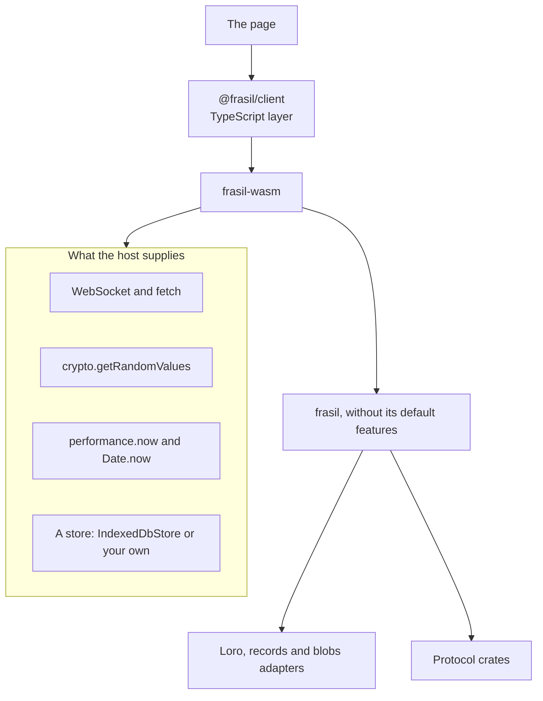
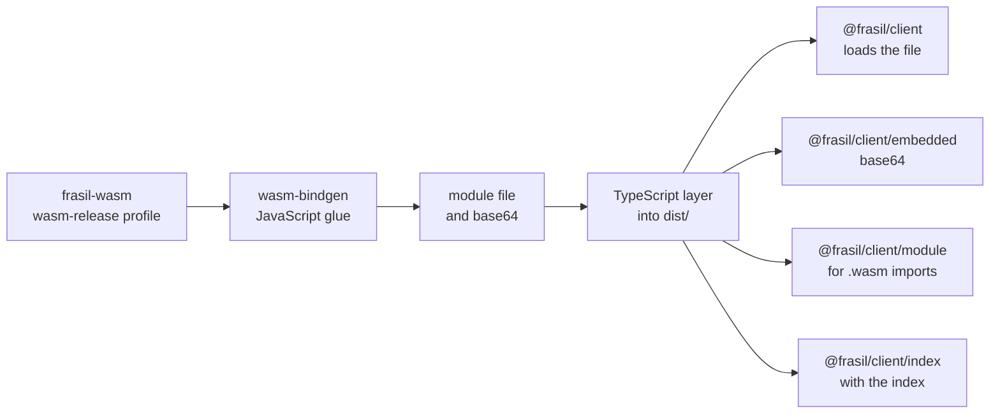

# WebAssembly

A browser runs Frasil through the npm package
[`@frasil/client`](../packages/frasil). It is the developer crate,
`frasil`, compiled for `wasm32-unknown-unknown` by
[`crates/frasil-wasm`](../crates/frasil-wasm), with a thin TypeScript layer
of the same shape: `Device`, `Storage`, `Space`, `Document`, `Records`,
`Blobs`, `Peer` and `Events`. Its [README](../packages/frasil/README.md)
is the guide for an application. This page covers what changes on the
WebAssembly target: what the module is built from, where its randomness,
clocks and storage come from, and what a page's Content Security Policy
must allow.

## A Rust application in a browser or a worker

An application with a Rust core of its own, compiled to
`wasm32-unknown-unknown` and run in a page or a web worker, uses `frasil`
directly with the `browser` feature, and opens a device as it does
natively:

```toml
frasil = { version = "0.1", default-features = false, features = ["browser", "adapter-records"] }
```

```rust
use frasil::{Device, Storage};

let device = Device::open(Storage::indexed_db("my-app-frasil"), &unlock_key).await?;
let space = device.create_space().await?;
device.connect("https://peer.example.org").await?;
```

- `Storage::indexed_db(name)` keeps the store and the sealed device keys
  in an IndexedDB database of their own, laid out as the npm package's
  `IndexedDbStore` lays it out; `Storage::Memory` keeps nothing.
- The device takes the browser's tasks and timers, its clocks
  (`performance.now()` and `Date.now()`) and the server binding over its
  `WebSocket` and `fetch` by default, and its store's restore mode is
  `never-restored`. `Options` changes any of them, as it does natively.
- `frasil::browser` holds the parts for an application that builds the
  platform itself: `IndexedDbStore`, `BrowserTasks`, `BrowserClock`,
  `BrowserConnect`, `BrowserSocket` and `platform`.

Recovery with a sheet or passkey retains the resealed keys through the
configured keeper. IndexedDB installs its own keeper automatically, so closing
and reopening the recovered device preserves its person. A keeper failure
rejects recovery.

The device runs on the thread that opened it: a page's main thread or one
worker's. Elsewhere than `wasm32-unknown-unknown`, the feature adds only
`server-socket`.

## What the module holds

`frasil-wasm` builds `frasil` without its default features, with:

- `browser`: the browser's tasks, timers and clocks, and the server
  binding over its `WebSocket` and `fetch` (`frasil::browser`), which the
  package and a Rust application share. A browser reaches peers over this
  binding only;
- `adapter-loro`, `adapter-records` and `adapter-blobs`: documents, record
  tables and files.

Left out, because a browser cannot run them: `sqlite` (the page supplies
the store), `iroh` and with it admission by code and member connections,
and `server` (the native WebSocket client). The peer, `frasil-relay`, never
builds for WebAssembly.



The protocol crates hold no IO, clock or randomness of their own, so they
build for `wasm32-unknown-unknown` unchanged. `frasil-wasm` is empty on
every other target.

## Building

`packages/frasil/scripts/build.mjs` builds the package from a clean state:



1. `frasil-wasm` for `wasm32-unknown-unknown`, with the workspace's
   `wasm-release` profile (optimised for size, with LTO);
2. its JavaScript glue, with `wasm-bindgen --target web` at exactly the
   version `Cargo.lock` pins. The macro and the CLI must agree, so the
   build fails on any other version;
3. the module's bytes as a base64 module, for the entries that embed it;
4. the TypeScript layer, into `dist/`;
5. the entries, each a copy of that layer that differs in one file,
   `engine.js`, which says where the module comes from:
   - `@frasil/client` (`dist/`): the file `dist/wasm/frasil_wasm_bg.wasm`,
     found with `new URL("./wasm/frasil_wasm_bg.wasm", import.meta.url)`,
     which bundlers emit as an asset. A browser compiles it while it
     downloads with `WebAssembly.instantiateStreaming`; the glue falls back
     to instantiating the bytes where the MIME type is not
     `application/wasm`. Node.js, Bun and Deno read the file with
     `fs`, since `fetch` takes no file URLs in every version;
   - `@frasil/client/embedded` (`dist/embedded/`): the base64 module, for an
     application that cannot host a file. It costs a third more to download
     and compiles only once all of it has arrived;
   - `@frasil/client/module` (`dist/module/`): the bare module, for a host
     that imports `.wasm` as a compiled module and refuses to compile from
     bytes;
   - `@frasil/client/index` and `@frasil/client/index/embedded`
     (`dist/index/`, `dist/index-embedded/`): a second build of
     `frasil-wasm` with its `index` feature, which adds the index and
     SQLite (see [the index](index.md)), loaded from a file and inlined.
     Only an application that imports one loads it; a dedicated worker
     finds the file the same way a page does;
   - `@frasil/client/client` (`dist/client.js`): `IndexClient` alone, which
     imports nothing that loads a module (`pnpm size` checks it).

The entries `@frasil/client/react`, `@frasil/client/svelte` and
`@frasil/client/solid` load no module: they adapt the package's stores to
each framework (see [reading and caching](reading-and-caching.md)).

```sh
rustup target add wasm32-unknown-unknown
pnpm install --frozen-lockfile
pnpm --dir packages/frasil build
```

`scripts/check-js.sh` installs `wasm-bindgen-cli` at the pinned version
into `target/wasm-tools` when the one on the `PATH` differs.

## Randomness

Every random byte comes from the host's `crypto.getRandomValues`: the Web
Crypto API in browsers and workers, and the same global in Node.js 20 and
later.

`frasil-crypto::random_bytes` is the client's one draw. It calls
getrandom, whose `wasm_js` feature `frasil-crypto` enables on this target
only. The procedures of the protocol crates draw nothing themselves: each
takes its random bytes as an argument. When the host has no generator,
`random_bytes` returns `NoRandomness`: never weaker bytes, and never a
panic, which would trap the module.

`crates/frasil-crypto/tests/wasm_randomness.rs` checks this in Node.js:

- with `getRandomValues` replaced by a stub that writes one constant byte,
  a wrap sealed with drawn bytes is the one that byte gives, and each draw
  is one call to the stub;
- with `getRandomValues` removed, and then with `crypto` itself removed,
  every draw returns `NoRandomness`, and draws work again once the
  generator is back.

## Documents from other writers

A panic traps the module on this target: nothing catches it. Before the
pinned Loro reads a document's bytes from another writer, the Loro adapter
walks them as Loro's decoder does and refuses, as `LoroMalformed`, bytes on
which the decoder would fail, panic or reserve memory out of proportion to
them, and bytes past the limits of [adapter-loro.md](spec/adapter-loro.md),
"The checks". Native builds also catch a panic inside Loro that this walk
does not foresee and leave those bytes out; here such a panic traps, and
every call then fails with `panicked`. A native application built with
`panic = "abort"` is in the same case.

A compacted document's state is walked the same way before Loro loads it,
up to the header of each container's state, and refused past the limits of
[adapter-loro.md](spec/adapter-loro.md), "Loading a state": 2^28 bytes, and 2^28 bytes once
decompressed. The rest of a container's state is decoded by Loro when the
container is first read; a state written by a compactor that does not
follow the specification can still trap the module there, or take memory
up to the run lengths its columns name.

## Clocks, storage and threads

`crates/frasil-wasm/src/platform.rs` supplies what the device runs on, from
`frasil::browser` and the application's store
([at-rest.md](spec/at-rest.md), "What the application provides";
[overview.md](spec/overview.md), "Clocks"):

- **Clocks.** `performance.now()` is the monotonic clock and `Date.now()`
  the wall clock, which counts as known unless the application says
  otherwise.
- **The store** is a JavaScript object with `get`, `scan` and `commit`,
  each returning a value or a promise. The package's `IndexedDbStore`
  makes each commit one IndexedDB transaction. A store that throws or
  rejects fails as `store`. A commit refused for want of room is told
  apart: see [Blobs in a browser](#blobs-in-a-browser).
- **The restore mode** is `never-restored` by default: a browser has no
  place that no backup restores. `none` makes every start count as a
  restore.
- **One thread.** The device's futures are not `Send` on this target,
  since a browser's storage answers through promises. Its upkeep runs on
  the page's event loop while the device is open.

## Blobs in a browser

The package binds the whole of the client's reads and retention
([Reading, following and caching synced data](reading-and-caching.md),
"What a device keeps of its blobs" and "Reading a blob that is not all
here"). Its [README](../packages/frasil/README.md), "Large blobs and media",
is the guide; this is what is particular to a browser.

- **A reader crosses one call at a time.** `Blobs::open_reader` becomes
  `blobs.openReader(id, options)`, and `BlobReader::read_at` becomes
  `reader.read(offset, length)`. A `frasil::BlobReader` takes `&mut self`,
  so the binding lends it to the call in flight and the TypeScript layer
  queues the calls. A call given up, by an `AbortSignal` or by cancelling
  `reader.stream()`, drops its future inside the module and then lets go of
  what the reader had asked of the space's connections
  (`BlobReader::cancel`), before the blob's header is known as after it, so
  nothing is fetched for a read nobody waits for.
- **Reading a large blob without downloading it.** A reader fetches the
  chunks it reads. With `{ uncached: true }`, and for a blob larger than the
  cache's budget, they stay in WebAssembly memory, `read_ahead + 1` sealed
  chunks at most, 9 MiB at the default, whatever the blob's size.
- **The cache's budget and the quota.** `Options::blob_cache` is
  `{ blobCache }` at `Device.open`, 256 MiB unless given. Over the
  package's `IndexedDbStore` the TypeScript layer lowers it, at each open,
  to half of what `navigator.storage.estimate()` says the origin may still
  store (its quota less its usage, plus what the cache holds already, and
  nothing when the origin is over its quota by more than the cache holds),
  and leaves it as given where the browser gives no estimate or one with no
  quota. Half leaves room for kept blobs, documents and the origin's other
  storage, which the same quota covers.
- **A write the browser refuses.** IndexedDB aborts a transaction past the
  quota with a `QuotaExceededError`. `IndexedDbStore` rejects the commit
  with a `store` error whose `cause` is that exception, and the binding
  gives the client `StoreError::full`, as `frasil`'s own
  `browser::IndexedDbStore` does. For the chunks a read fetched, the client
  then drops cached blobs, the one read longest ago first, until as many
  bytes went as the chunks take, and commits again, once; refused again, the
  blob's open readers take the chunks into their own memory and the read
  goes on as an `uncached` one. With no reader open, as under `keep`, the
  chunk is refused and the download fails; a `put` and every other write
  fail with the store's error, and evict nothing
  ([reading-and-caching.md](reading-and-caching.md), "What a device keeps
  of its blobs"). An application's own store says the same by rejecting
  with an error named `QuotaExceededError`.
- **Media elements.** A `<video>` or `<audio>` element reads from a URL,
  and the client cannot run in a service worker, since a service worker is
  stopped between events and holds no device. `@frasil/client/media` mints
  a URL on the page's origin and answers it from a service worker that
  forwards each request, with its `Range`, over a `MessagePort` to the page
  or worker that runs the client, which reads the range through a reader
  and gives the bytes back a piece at a time, as the element takes them.
  The service worker keeps only each page's ports, by the page's client ID,
  one for each `MediaServer` the page connected, and asks the page for them
  again when it has none, as after a restart. A URL begins with the name of
  the server that minted it, which is how the worker finds its port. It
  answers `206` with `Content-Range`, `Accept-Ranges` and `Content-Length`
  for one range, `200` for none or several, `416` for one past the end,
  and a `HEAD` with no body.
- **A URL is never a document.** The worker answers `404` to a navigation
  and to a request whose destination is a document, a frame, an `<object>`
  or an `<embed>`. Every answer carries `X-Content-Type-Options: nosniff`,
  `Content-Security-Policy: sandbox; default-src 'none'`,
  `Cross-Origin-Resource-Policy: same-origin` and `Cache-Control: no-store`.
  The media type told is the application's when it is `audio/…`, `video/…`,
  `image/…` other than SVG, `application/ogg` or
  `application/octet-stream`, and `application/octet-stream` otherwise: an
  application must still not pass a type from untrusted metadata, since the
  URL is on its own origin.
- **The service worker's script.** Service workers need a secure context.
  `media-sw.js` calls `skipWaiting()` and `clients.claim()`, so registering
  it at a scope that already has a service worker replaces that worker at
  once; an origin with a worker of its own calls `handleMedia` from it
  instead, first in its `fetch` and `message` listeners, with the same
  prefix as the page, which ends with a slash and is given one if it does
  not. `MediaServer.connect` rejects with `timeout` when no service worker
  has taken the page's port within ten seconds.

```ts
import { MediaServer } from "@frasil/client/media";

const media = await MediaServer.connect({ serviceWorker: "/media-sw.js" });
const stop = media.serve(document.querySelector("video"), blobs, id, { type: "video/mp4" });
```

The script `media-sw.js` is in the package's `dist/`; host it where its
scope covers the pages that play media, or call `handleMedia` from
`@frasil/client/media/worker` in a service worker of your own.

## 32-bit sizes

`usize` has 32 bits on `wasm32`. The deterministic CBOR reader converts
each length with `usize::try_from` and refuses one that does not fit as
`Malformed`, and it decodes at most 16 levels deep
(`frasil_base::cbor::MAX_DEPTH`). An object's size and its chunk indices
are `u64` on every target.

## Content Security Policy

Compiling WebAssembly is governed by `script-src`. The package loads,
opens a device and syncs with a peer at the page's own origin under:

```text
Content-Security-Policy: default-src 'none'; script-src 'nonce-…' 'wasm-unsafe-eval'; connect-src 'self'
```

`packages/frasil/test/binding/csp.spec.ts` serves the real package under
this policy and under one change at a time, in Chromium and WebKit. Each
case writes what happened, with the console's errors, to
`packages/frasil/test-results/csp-<engine>.json`.

| Case | Chromium and WebKit |
|---|---|
| The policy above, static `import` | loads, opens a device, connects |
| The policy above, `import()` | loads, opens a device, connects |
| Without `'wasm-unsafe-eval'` | the module does not compile |
| `'unsafe-eval'` instead | loads, opens a device, connects |
| Without `connect-src`, the default entry | the module file is refused; nothing loads |
| Without `connect-src`, the embedded entry | loads and opens a device; the peer is refused |
| With `require-trusted-types-for 'script'; trusted-types 'none'` | loads, opens a device, connects |

So a page needs `'wasm-unsafe-eval'` in `script-src`, and `connect-src`
for its peers. It needs no `'unsafe-eval'`, no `'unsafe-inline'` and no
`worker-src`, and it may enforce Trusted Types. `'unsafe-eval'` also
works, but it allows `eval` and `new Function`, which
`'wasm-unsafe-eval'` does not. The default entry fetches its
module file, so the file's address must be allowed by `connect-src`; the
embedded entry instantiates bytes it already holds and needs none for the
module.

Without `'wasm-unsafe-eval'`, Chromium reports a `CompileError` saying
that compiling the module violates `script-src`, and WebKit a
`CompileError` that it refused to create a WebAssembly object. A peer at
another origin must be named in `connect-src`; the peer answers the
browser's CORS preflights itself ([self-hosting.md](self-hosting.md)).

## Tests

- `scripts/check-wasm.sh` builds `frasil-wasm` for `wasm32-unknown-unknown`
  and runs, in Node.js, the vector tests of `frasil-crypto`,
  `frasil-events`, `frasil-store` and `frasil-units` again
  (`crates/frasil-wasm/tests/vectors.rs`, with the vector files compiled
  into the module), and `frasil-crypto`'s randomness test.
- `scripts/check-browser.sh` runs the `frasil` crate's browser tests
  (`crates/frasil/tests/browser.rs` in a page, `browser_worker.rs` in a
  dedicated worker) under wasm-bindgen-test in headless Chromium: a device
  over IndexedDB that keeps its spaces, records and keys across a
  reopening, and one in memory.
- `scripts/check-js.sh` builds the package from a clean state, type-checks
  it, runs its unit tests in Node.js, runs the scenarios against
  `frasil-relay` and the policy check in Chromium and WebKit with
  Playwright, checks its size budgets, and lints it. Among the scenarios,
  `reads.spec.ts` reads blobs the device does not hold, through a read's
  options and through a reader, under a cache budget and over a store that
  refuses writes for quota; `media.spec.ts` asks the media service worker
  for ranges and plays and seeks a `<video>` element through it. Playwright's browsers
  must be installed already, WebKit included, since WebKit runs by default:
  `pnpm --dir packages/frasil exec playwright install chromium webkit`
  (from `packages/frasil`, `npx playwright install webkit`).

CI runs all three on Linux, with clippy on `wasm32-unknown-unknown` first.
CI runs Chromium and WebKit.

`Space.pending_authored_changes().await` (npm `space.pendingAuthoredChanges()`,
a `bigint`) counts locally authored events awaiting the same acknowledgement
as `flush()`. It counts units and roster, key and storage events, rather than
application operations. An always-on peer acknowledges durability; without
one, another member can acknowledge it. `Event::PendingChanges` (npm
`pendingChanges`, with `space` and `count`) reports observed count changes.
Rapid changes may coalesce; read the method for the current count. The first
notice for a space establishes its observed count, including zero.

For an already authenticated device, `Device::admit_spaces_via_peer` grants
administrator access with history to many spaces using the device's direct
grant in one known space. `Device::receive_spaces_via_peer` collects and
verifies the welcomes. Their npm counterparts are `admitSpacesViaPeer` and
`receiveSpacesViaPeer`. Both accept a progress callback and return one
report per space: `{ space, granted, error? }` in npm. An error may follow a
committed grant; retrying failed or unfinished spaces is safe. The expected
identities and space IDs come from the application's authenticated context.

For a retained erasure, `device.retryErasure(space)` asks the saved peers
immediately. The event stream reports `erasureLateAtPeer`,
`erasureCheckpoint` (checkpoint ID and slot standing),
`erasureAwaitingWelcome`, `slotHeld`, and `erasureCannotErase`. A contradictory answer
reports `peerError` with its encoded, untrusted answer; it counts as
unanswered. The residue remains until the peers answer `erased` or
`device.giveUpSpace(space)` gives it up. A successful welcome starts fetching;
the device then signs the erasure again, reports `erasureVoid`, or reports
`slotHeld` while its erasure waits.

When another pseudonym holds this device's administrator slot, `SlotHeld`
(`slotHeld` in JavaScript) names the space and holding root or enrolment,
identifies the holder as another installation of this device, another device,
or unknown, and says whether this device's erasure waits on it. A residue
has no keys and reports unknown. It keeps asking peers, without requesting
a welcome for a slot the cut names as held. Use the other installation to
administer, or ask another administrator to disown the slot and grant a new
one. An occupied slot cannot be enrolled again.
